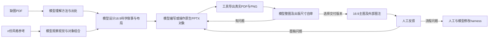

# Drawing harness v2.5.1：从缺图论文到16:9方法主图

版本适配：2026-10-12。继承v2.5的科学绘图策略；v2.5.1采用通用模型接口和公开Python作者后端。模型在一次生产上下文中执行，外层仅由人工指导，不运行evolving。

独立入口和工具合同见随包README.rst与protocol/model.txt。以下历史学习所得策略可用于生产，但历史样本和伴随材料不属于生产输入。

## 1. 任务与输入输出

**输入：缺方法主图的论文PDF＋n份风格参考图，n≥1。输出：该论文对应的一张16:9方法主图。**

正式生产参考只提供PNG/JPEG/WebP图片，不输入参考论文PDF、PPTX或逐样本teacher解读。模型从目标缺图PDF确定科学含义，从参考图片观察视觉表达；不能声称看图已核验原生对象类型或参考科学机制。

- 离线学习是独立分支：[PDF—图片—PPTX联合参考学习](REFERENCE_JOINT_LEARNING.zh-CN.md)。通过完整参考PDF、对应原图、PPTX及其实际渲染建立语义—视觉—对象匹配对，由模型事前解读并经人工反馈整理通用经验。
- 正式生产不按参考图片hash/ID隐式取回对应PDF、PPTX或teacher解读；若以后增加检索增强，另定义输入合同。指南中的跨样本通用经验可用，不把离线逐样本证据伪装为图片推理。
- 参考来自目标论文之外，n≥1，不固定3张、level或24张范围。论文身份ID可选，明确同ID会被拒绝；没有ID仍需模型判断来源并记录未知部分。
- 生产`prepare`默认`production`并拒绝参考PPTX/native companion。历史输入包仍可执行；只有显式`legacy-reference-inspection`可复查旧式输入，不能称正式生产。
- 用户请求可直接来自当前会话；可选request文件用于快照。方法范围优先用户指定，否则模型从PDF判断，不自动选择图注。
- PDF不必整页空白。模型说明移除了哪幅图/子图、还保留哪些相关图，记录是否见过历史目标，不能把同会话修订称为独立盲测。缺图/来源审查是模型职责，不是工具已证明的事实。

正式交付：`main-figure.pptx`（单页、原生可编辑主稿）、`main-figure.pdf`、`main-figure.png`，以及外部`figure-caption.md`。PPTX与PDF须16:9，PNG只容许像素取整误差。工作尺寸可1600×900，物理尺寸/分辨率可等比变化。主图无PPT全局标题、宣传副标题或装饰页脚；阶段名、子图编号和必要的总目标可留在图面。长解释进图注。

附带设计出处与模型自审记录，便于审阅；它们不是图面内容。历史输出不覆盖，也不能直接非等比拉伸为16:9。

## 2. 模型与代码的职责

|环节|模型执行的关键判断|代码辅助|
|---|---|---|
|论文理解|确定方法范围，理解实体、操作数、流程、条件、表示、监督和参数更新，核对页码/公式|快照PDF、抽取文字、提供查看工具|
|参考学习|离线联合PDF/图/PPTX学语义与对象；生产从图片观察表征和布局，决定可迁移内容|离线暴露native证据；生产快照参考图片，不隐式取teacher材料|
|科学构图|确定主线、步骤分块、重点、信息密度、颜色/字体、画布坐标与路由|提供通用对象写入API与机械单位换算|
|绘制|亲自编写自由authoring代码或执行原生对象操作，设计组合/图像/公式|执行代码、序列化PPTX/OfficeMath、实际导出渲染|
|评审与修改|看真实像素和出版尺寸，判断逻辑、内容、视觉问题，逐对象修正|保留每轮代码/决策/图稿/失败/渲染和哈希|
|交付|明确选择已审查版本，写图注与限制，交给人工评价|核验单页16:9及文件一致性，复制选定产物|

没有固定scene角色词典、自动科学图编译器、自动版式、自动审美评分/晋升、自动修复或固定精修轮数。尺寸检查只能报错，不能自动拉伸、缩字号或重排。可以使用可复用的底层组件，但其内容、适用性、位置和组合仍由模型决定。v2.5.1的run命令负责外部模型调用与工具循环；桥接模式由当前模型选择相同工具。机械命令执行成功不构成完成绘图。

## 3. 一次绘图的完整闭环



**准备。** `prepare`制作不可覆盖的输入包。正式生产模型打开目标缺图PDF及每份参考图片。离线学习另走reference_learning入口，才查看完整参考PDF和native证据。读取数字不能代替视觉观察。扫描型PDF文字抽取为空时，模型仍需看页面，不把“无文字”当“无方法”。

**理解。** 模型自由整理“输入是什么→发生何种变换→产生何种表示→谁消费它→用什么条件/监督→谁更新谁”。每个关键模块、条件、公式和关系有PDF页码/段落出处。明确核心方法、辅助目标、训练/推理分支及图注细节。不得用风格参考补造目标缺失的方法。

模型判断阅读范围时，检索并查看目标PDF中相关的Implementation Details/附录，核实条件来源、参数状态和阶段差异；不把“已读方法正文”当成理解完成，也不把“当前段落没写”直接当成“论文未说明”。未知状态不能补造，已有明确来源的状态不能一起省略。布局前自由记录核心机制必须保留的操作数、变换、中间表示、消费者和训练身份；说明主动省略的关系及理由。减少长文字不意味着删除关键机制，将创新名称放进框里也不等于表达创新。此记录由模型解释，不是固定scene schema或代码编译输入。

新生产轮将理解与表征规划分别写成自由Markdown记录，经`execute --model-evidence understanding=... --model-evidence representation=...`随每个iteration快照。理解记录交代实际阅读范围、核心依赖、模式/状态及未知项；表征记录在定坐标前说明保留/展开/省略关系、参考局部如何迁移及图面如何被读回。工具只检查非空、路径标签和字节一致性，不解析或代替模型理解；历史未提供记录的run仍可复现。模型不能把记录文件存在当成完成了理解。

**学习与设计。** 按[参考风格学习](STYLE_LEARNING.zh-CN.md)观察参考图片，运用离线已总结的对象构造经验，分别记录几何、叠层、明度/饱和度分布、轮廓与主次线、字体/image分工、热点与留白，而不是只概括“浅底/分块/token”。在自由文本`model-decision.md`写出科学主线、整体风格取舍、具体参考局部到目标对象的迁移、六类角色、颜色/字体、16:9步骤分块、坐标和连线依据。与最近不同论文的输出比较，排查默认样式继承。不是固定模板，不要求使用全部六类，也不是固定五块。

参考解读先解释信息组织，再解释外观。在自由表征记录中选择参考的关键局部，说明读者能从哪些具体内容、字段排列、关系结构或状态差异理解一次变换；区分真正承载机制的组合与仅承载名称的容器。随后说明目标中对应的关系如何展开、哪些参考能力适用或不适用。使用变量、公式或减少文字都不是省略核心变换的充分理由；不强制具体例子或图标，结构本身能解释机制时可保持抽象。参考自身的抽象程度和弱点也应记录，不能按未输入的目标原图风格判错。

迁移的单位是参考的解释能力，不是组件清单。模型解释参考如何使某种关系、变化、差异或作用可理解，再决定目标中哪些核心部分需要同类解释；视觉材料及表达粒度由目标语义与参考共同决定。参考内容不能移植为目标事实。图中表达方法的作用或差异时，应区分方法意图、说明性解释与实测结论，不把可视化解释当作效果证据。

压缩须保留解释所需信息。在布局前及修订中，模型对关键省略自由说明：改成名称、变量、颜色或移入图注后，图面还提供哪些依据让读者理解核心操作及其作用；若必须依赖作者已知的论文内容补齐，应重新选择展开粒度。并非每个节点都需展开，不要求具体例子、图标或长文字，抽象结构与公式也可完成解释。证据不足时保留未知，不以禁止虚构为由放弃已有依据的表达。目标是有选择地保留解释，不是展示所有细节。

规划同时检查局部完整与解释连续。对核心过程，模型说明相邻操作之间哪些身份、内容、状态或条件保持，哪些改变，产物如何成为后续输入；跨表示、跨区域、重复或细分过程都不能只凭同名标签推定承接。不同承接关系不得互相替代。省略重复过程可以，但应保留足以读回关键接续的依据；表达方式由模型决定，不强制逐阶段完整复制对象或使用某类状态符号。

解释粒度、面积与最终展示尺度共同决定。模型在表征规划时同时考虑需要读出的核心差异、局部展开、重复程度和空间预算，而非先锁定布局再塞入全部内容。实际渲染暴露拥挤或关键细节难辨时，可重新组织主次、摘要或展开、分配面积及调整排版；不能默认缩小文字，也不能为规整删掉必要关系。参考物理字号不能跨画布直接复制，不设全论文统一的对象数、字号或分栏模板。

**绘制与导出。** 模型写authoring代码或直接操作原生对象，导出单页candidate.pptx。采用当前演示工具时按其要求做包/几何/导入检查。`execute`保留模型源代码与决策，核验16:9/单页、实际渲染PDF/PNG；失败保留，不自动重试。工具成功不代表内容或视觉合格。

作者在执行前将理解记录中的关键关系与实际对象及连接核对，在自由决策记录中指出其落点和有依据的省略。操作的旁注不能默认代替操作本身，数据流不能默认代替参数更新；涉及集合构建、选择、变换或状态更新时，模型检查输入、作用与产物是否在图面区分。不同科学角色可以共享外框，但内部组织应承担各自信息，不能只换名字和颜色。底层helper不决定科学展开粒度；图面不必给每个操作单独加框。

**自审与精修。** 模型打开每轮真实PNG及工具同时生成的出版缩小版（例如180mm宽/150dpi），并列查看选定参考和近期不同论文输出，审查预定对象组合、对比层级和视觉热点是否兑现，是否回到旧浅底卡片表达。沿每条主路径检查输入、条件、产物、监督与更新；对照公式操作数、标签、边界、分块、留白、字体回退、交叉和图像身份。写自由`model-review.md`，区分科学正确、技术可编辑、参考表达兑现；有问题则改原生对象/布局并产生新iteration。用户明确授权时可以由另一个模型评审，但不能把它当默认后台自动流程或替代人工标准。

自审还应从成稿像素重新读回方法，与布局前保留的科学关系对照：核心创新的操作数/变换是否可追踪、局部机制位于哪类真实组件、模式与更新身份是否能辨认，避免仅检查模块名称和路径存在。已知核心机制缺失、错误状态或未兑现的关键对象组合，应先由模型修复；不能仅写成“留待人工反馈”再交付。外部图注可解释细节，不能替代主图中应可读的核心关系。人工决定接受标准，模型仍承担交付前落实已有要求的责任。

自审在同一模型环节内采用两次不同视角，不增加默认评审模型或自动评分。先暂时放下作者的解释，只从实际成稿读回实体、操作、条件、产物和状态：在自由review中指出具体可见证据及仅能靠记忆补出的关系，再与理解记录核对。模型无法抹去自己的记忆，因此不能称独立读者盲审；不得把计划中的机制当作像素已证明。之后并列输入参考，检查信息组织能力是否兑现，包括内部结构、变换展开与角色区分；颜色、外框、叠片匹配不足以放行。发现差异先判定是否由参考本身、目标语义差异或生成遗漏导致，明确核心遗漏并修正后再选定交付。

自审区分存在性与解释充分性：对象、操作数和连线存在，可证明流程有所表示，不能单独证明核心关系、变化和作用可理解。模型从实际图面指认支撑解释的可见依据，说明图面表达的范围及仍需背景知识之处；以论文理解核对真实性，以输入参考校准表达能力。仅有名称或状态标识未必是缺陷，只有它们承担了尚未兑现的核心解释时才需修订。不能按标签、图标、示例、形状或公式数量判定完成，也不能用通用规则强迫所有论文采用同一展开形式。

出版尺寸审查以实际读取任务为准，不只确认“看得见”。模型在缩小后的真实像素中检查能否稳定区分关键符号及相近索引、对应操作数与比较对象、识别变化，并追踪前后承接；自由review注明支撑这些判断的局部证据与必要背景。局部都存在却无法接成核心过程，或关键标记只能凭作者记忆猜出，应返回表征/布局修订。可编辑对象、字体编码、无溢出和包校验均不代替终端阅读；不自动评分或按字号阈值放行。没有明确目标出版尺寸时注明预览假设，不把该假设称作用户要求。

**选择与交付。** 模型明确选择iteration，写外部图注。`deliver`核验候选、审查与渲染仍与记录一致，核验PPTX/PDF/PNG比例并复制产物，附出版尺寸预览。模型在发给用户前打开最终预览。该命令不替模型评图或选最佳版本，记录`human_acceptance=pending`。人工反馈后分别修作品或修框架；不为一次修稿宣称泛化、level收益或框架进化已证明。

## 4. 六类对象如何联合表达

六类是表达角色，与OOXML底层类型不是一一对应；formula/arrow/concept matrix也可能存为sp。group/table另记组合结构。详细参考观察见[对象组合学习](OBJECT_COMPOSITION.zh-CN.md)。

|角色|信息与位置|组合原则|
|---|---|---|
|文字|名称、属性、状态和局部限制，贴近对象/操作|精简说明但保留必要身份；段落背景放图注|
|公式|精确条件、运算和目标，贴近操作/比较|操作数必须在图上有来源；原生方程或可编辑对象级数学排版|
|shape|实体、序列、向量、集合、范围、mask、模块|嵌套/偏移/覆盖/前后层有语义；不让层数暗示不存在的网络深度|
|线/箭头|产生、流程、条件、比较和更新|端点对应实际节点，合并接全操作数，交叉不误连，区分数据和参数更新|
|image|真实输入、不能简化的现象或结果证据、适当说明性意象|和可编辑标注/放大连接组合；不把文本模型画成图像模型，不用整图位图隐藏关键结构|
|chart|实测比较、分布、趋势或消融|贴近被验证的主张，轴/单位/数据有来源；概念矩阵不冒充实测热图|

提高的是单位图面可读的科学关系与机制，不能用增加文字/对象/色块或填满画面替代信息密度。六类无需每图用齐。

## 5. 配色、字体、分块与版面

模型从参考的整套视觉关系学习配色，包括fill/stroke、明度/饱和度、面积、主次线与热点，需要时检索有来源的palette。不默认压低饱和度或统一为淡蓝/淡绿，不把多份参考平均成浅色主题。语义色贯穿同一角色，文字/轮廓/背景有层级；一般实体与内部组件不无理由借用另一角色的颜色。浅色、强色、灰实心或裸露白底都可依据参考与科学需要选择。既有SciencePlots/PaulTol与Catppuccin研究是实例，不是固定主题。

模型按本论文的真实阶段分块，步骤数量、顺序和大小随方法决定。分块可由空间/对齐、局部名称、括号、边界或色面实现；规整不要求给每步骤添加浅色底板。几何、轮廓、边界强弱和对象材料依据当前参考决定，标题基线、列间距和分支对齐保持规整。先保留科学依赖再安排跨块通道，不为整齐删条件或监督，不把所有对象压成同型文本框。可以复用机械写入API；旧作者代码里的C/card/stage/encoder样式默认值属于旧作品设计，新稿须重新决定。

正文与数学有明确字体分工；变量、正体算子、上下标、帽符、范数保持科学排版。检查实际渲染与字体回退，不能把写入字体名称当作该字体已真实呈现。连线不穿字，关键操作不悬空，注意力主次分明；声明原生PowerPoint检查必须确实在该软件查看。

字体选择不固定为某个helper默认值。可选Times New Roman、Georgia等衬线正文，Arial、Helvetica、Noto Sans等无衬线正文，以及Cambria Math、STIX等数学字体；这里只提供候选，须先核实环境可用性和实际字形。Times New Roman作为常用科研候选正式纳入选择范围，但不强制所有参考或所有角色统一使用。模型依据参考、文字语言、数学符号覆盖和最终尺寸决定正文/局部标题/数学的搭配，在决策中写明理由和回退。数学变量的斜体、正体算子及真正上下标单独决定，不能以Unicode近似字符或换字体代替数学排版；普通文本式数学须如实声明。渲染后检查字体实际生效、符号及字宽变化引起的截断，不能只查PPTX字体名称。

### 图像和chart的获取与生成试验

模型先说明需要读出的信息以及当前表达缺口，再决定是否需要image/chart。真实实例、输入或结果优先使用获准输入PDF中的清晰裁剪/提取，并记录页码、局部身份和裁剪范围；生产不得因此访问被隔离的目标原图或参考伴随文件。必要的对应、选择、结构、公式和连线保留为原生可编辑对象。简单可编辑机制示意已有足够表达时，不强制生成位图。

生成插图适用于需要表现输入类型、空间/物理场景、难以用少量原生对象表达的形态或说明性意象，且缺少适用真实素材的情况。目的须对应科学解释：帮助识别实体、定位局部、区分场景或理解现象。仅填空、装饰、形状更丰富或“用了ImageGen”不是必要性依据。生成素材可以试验后舍弃；模型不能为了履行生成次数把无信息增益的插画塞进主图。

生成前记录素材角色、所依据的目标语义、要保留/不得暗示的属性、尺寸及需原生覆盖的标签；使用可用图像生成工具只生成局部素材。生成后检查幻觉细节、身份变化、尺度和图面注意力，再决定保留、重做或拒绝。说明性素材须可识别为说明性，不能冒充真实样本、预测、显微图、分子准确结构或实验结果。数据身份与精确结构必须由来源及可核验表达保障，不能依赖生成器自动正确。

chart表达有来源的数据关系，按需要提取目标PDF数据或使用明确授权数据并记录位置、单位、条件及近似；不能用图像生成器制造数值、性能曲线或实验热图。无实测主张时可以不画chart。概念关系用原生示意表达并标明范围，不冒充测量。试验阶段可保存带/不带素材的版本，模型说明素材增加了什么、占用了什么；正式是否保留仍由目标与当前参考决定，不把单次试验固化为模板。

## 6. 工具入口与记录

### 生产闭环补充：阅读任务、表征需求与组合复核（2026-10-10）

以下由生产模型执行，不增加自动布局器、默认评审代理或固定对象配额。

- **阅读任务与空间共同规划。** 定坐标前说明各关键局部要求读者识别什么、理解什么变换、比较什么状态、追踪什么条件或监督；据此同时选择展开/摘要/重复方式与空间预算。不能先固定各区占比再塞细节。渲染后既检查局部辨识，也检查整条过程的追踪与全图阅读负担是否协调。局部能读不等于整体协调；“有意密集”不是放行证据。需要调整时由模型重新组织粒度、分组、面积与排版，不默认缩字号或等大分区。
- **表征需求先于素材可得性。** 先判断实体识别、模态、空间关系、实例连续或结果差异是否需要视觉表征，再选择文字/公式/原生示意/获准真实裁剪/说明性生成素材。某种真实素材不可用只关闭该获取路径，不证明需求不存在。参考图片中的具体内容不可复制为目标事实，但其识别与解释功能可迁移。抽象表达足够时可不用image，缺口仍在时继续比较适当表达；说明性材料与真实样本、预测及实测结果明确区分。
- **关系线与文字联合设计。** 端点、全程通道、路径标签、邻近说明和图例作为同一组合安排。实际像素复核覆盖数据、条件、监督、更新及关联线，检查端点科学含义、文字冲突、误连接与路径辨识；不能只审主数据箭头。移动对象、改字或字体后重新查看受影响组合。机械几何检查仅作提示，不能自动代替语义或修正决策。
- **可见证据放行。** 自审从成稿指出关键阅读任务的可见依据、适用背景及未兑现部分，并与参考的解释功能核对。规划记录、对象存在、技术检查通过和作者意图不能代替兑现证据。发现缺口返回表征、布局或绘制修订；分别记录问题发生处与漏检处，不以自审结论证明自审可靠。

```sh
python run.py prepare --workspace runs/NEW --inputs INPUT_DIRECTORY --model ACTUAL_MODEL
python run.py run --workspace runs/NEW --config examples/your-provider.json
# 当前会话/任意代理可以用同一通用工具合同：
python run.py tools
python run.py call --workspace runs/NEW --json TOOL_REQUEST.json
```

记录包括：inputs与哈希、figure_contract、论文文字、生产参考图片、模型指南快照；独立离线库含完整参考PDF/PPTX的渲染、对象及语义对齐；每轮builder/decision/execution/native evidence/render/review；最终选择与delivery哈希；human-feedback。原始文件及已交付目录不覆盖。

`--model-evidence LABEL=MARKDOWN`可重复，标签只允许普通小写字母/数字/下划线/连字符。记录由模型在执行前提供，失败也保留；review/deliver核验未修改，交付复制相应记录。CLI不强制科学内容schema，不自动评判记录是否完整；正式流程是否真正落实仍需模型自审与人工反馈。

辅助证据不是科学判断。原始/派生文件快照不等于操作系统隔离；执行依赖不密封，外部helper/运行环境需由模型在记录中披露。HTTP模式保留模型响应、工具调用和可获得的usage；桥接模式须记录模型身份及上下文限制。两者均不证明输入已完全去掉目标图或所有引用都已语义核验。

## 7. 版本界限

新`prepare`生成v2合同，`execute`开始核验单页16:9。旧v1输入仍能读/执行，以保留历史实验；不追溯改写历史输出。正式`deliver`始终要求16:9，旧非16:9作品需模型重新构图生成新版本后交付。历史的原生chart、group、字体与科学内容限制必须按实测证据陈述。
