# AutoResearch 新手使用手册

图文操作版 · 18 张真实前端截图与编号指引

从第一次打开网页，到完成选题、实验、论文和表格交付  
适用版本：本地源码 67381b8 · 编写日期：2026-10-21

[下载 PDF 图文版](AutoResearch_软件使用说明书.pdf)

## 阅读导航

这份手册按用户在网页中的实际操作顺序编写。按钮名称、表单字段、状态和页签均依据五个前端页面及其 JavaScript 行为核对。本文未把演示输入当作真实科研结果，也未对付费模型、正式训练做完整实测。

| 你现在想做什么 | 从哪里读 |
| --- | --- |
| 第一次接触，不知道该点哪里 | 第 1-3 章 |
| 从方向开始，自动衔接实验和论文 | 第 4 章 |
| 只想找论文、看 Idea | 第 5 章 |
| 已经有 Idea，想设计或运行实验 | 第 6 章 |
| 已经有实验材料，想生成论文 | 第 7 章 |
| 已经有论文或数据，想整理表格 | 第 8 章 |
| 按钮不能点、任务停住或下载不了 | 第 9-10 章 |
| 需要启动软件、远程访问或备份 | 附录 A-C |

操作约定：“点击『按钮』”指网页中可见的按钮；“展开”指点击带折叠功能的标题；斜杠连接的名称表示按钮会随状态改变。示例名称、目录和数值仅用于说明填写方式，实际使用必须替换为自己的材料。

## 1. 先弄懂：这个软件替你完成什么

AutoResearch 的网页品牌显示为 The ThAInker。顶栏下有一个“工作台”和四个模块。工作台负责把多个阶段串起来，各模块负责具体工作。

| 入口 | 用普通话解释 | 开始前准备什么 | 结束后得到什么 |
| --- | --- | --- | --- |
| Auto Search | 帮你找值得研究的问题和解决思路 | 一个尽量明确的研究方向 | 论文、问题分析、方案和评审 |
| Auto Design | 把方案变成可执行实验并分析结果 | Idea、可用机器、数据与资源限制 | 设计文档、真实实验结果、诊断和审计 |
| Auto Writing | 按实验材料写论文 | 实验说明文件和支撑资料 | 英文章节、引用、论文源码与 PDF |
| Auto Table | 把实验表格整理清楚 | 论文 LaTeX ZIP 或结果文件 | 表格、论文或表格 PDF、复核记录 |

### 1.1 两种使用方式如何选择

“全流程”适合希望从一个方向持续做到最终论文的用户。你在首页创建一次任务，系统在条件满足后交接给下一模块；需要选题、审批或修复故障时再停下来。

“独立模块”适合你已经有上游材料。例如已有实验结果就进入 Auto Writing，不必重新调研和训练；只想美化已有论文表格就进入 Auto Table。

第一次使用建议先独立做一次 Search，熟悉如何看证据；已经明确研究目标和资源后，再尝试全流程。全流程启动会推进到真实实验阶段，因此不能当成一个只生成文字的演示按钮。

### 1.2 常用术语小词典

| 页面术语 | 含义 | 你需要做的事 |
| --- | --- | --- |
| Weakness | 现有工作的具体不足 | 检查论文证据是否真的支持它 |
| Idea | 针对不足的研究方案 | 判断是否值得投入实验 |
| Motivation | 为什么要做这项研究 | 明确问题和意义 |
| Contribution | 计划贡献哪些新东西 | 检查是否对应问题、能否验证 |
| Benchmark | 可用于比较的公开测试任务或标准 | 确认数据能取得、评价方式明确 |
| Baseline | 用来比较的已有方法 | 保证比较条件合理 |
| Backbone | 方法使用的基础模型或网络 | 在材料中写清名称与版本 |
| Seed | 随机种子；不同 seed 对应重复实验 | 核对重复次数和真实结果 |
| R0 | 正式实验前按计划执行的探测 | 看是否满足进入正式实验的条件 |
| 审计 | 检查实验记录与证据完整性 | 阅读结论和未解决问题 |
| LaTeX ZIP | 可编辑的论文排版工程压缩包 | 后续改稿时保留，不只下载 PDF |
| Revision ID | 某次方法修改提案的编号 | 只针对当前提案做决定 |

### 1.3 哪些事不会自动发生

打开页面、切换模块、选中列表里的任务，都不会因此启动新的研究。关闭网页通常也不会停止服务器中的任务。需要暂停或停止，应使用任务上的对应按钮。

论文调研、写作和评审会调用配置好的模型；实验可能真正占用 GPU。等待时间取决于文献网络、模型和实验规模，界面没有可通用于所有任务的完成时长。

## 2. 第一次打开网页：认清页面布局

以下默认软件已启动，你已有可访问的网址。本机默认是 `http://127.0.0.1:8760/`，远端访问方法见附录。

### 2.1 首页从上到下怎么看

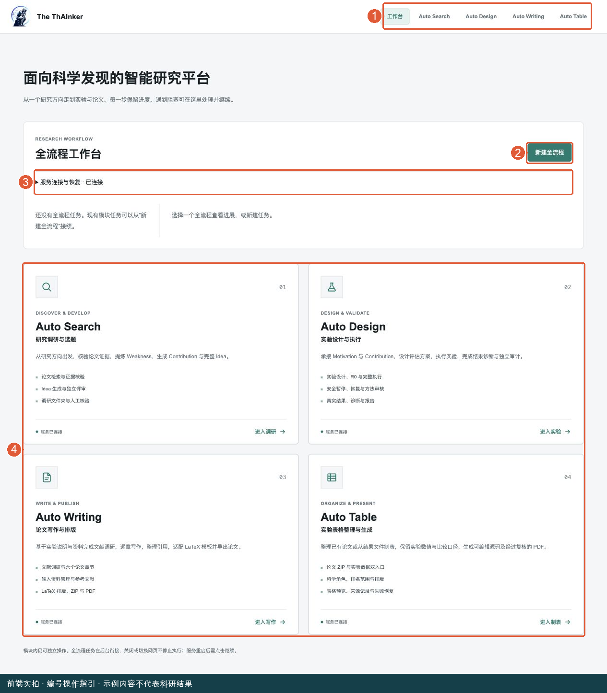

图中编号：1 顶部导航切换模块；2 点击新建全流程；3 服务恢复入口；4 四模块卡片可独立进入。首次使用先认清这四处，不需要先修改工具路径。


首页标题是“面向科学发现的智能研究平台”。其下首先是“全流程工作台”，再往下是四个模块卡片。

| 区域 | 位置与内容 | 新手怎么用 |
| --- | --- | --- |
| 顶部导航 | 工作台、Auto Search、Auto Design、Auto Writing、Auto Table | 随时返回首页或切换模块 |
| 全流程标题栏 | “全流程工作台”和“新建全流程” | 从方向启动完整研究 |
| 服务连接与恢复 | 可展开的服务面板 | 只有服务异常或路径需要调整时再操作 |
| 全流程列表 | 已建流程的标题、状态、阶段和更新时间 | 点击标题，在右侧查看详情 |
| 全流程详情 | 四阶段、当前消息、模块链接和控制按钮 | 判断下一步要等还是要处理 |
| 四张模块卡片 | 调研、实验、写作、制表 | 不走全流程时直接进入具体模块 |

第一次没有任务时看到空列表是正常现象。点击“新建全流程”会展开表单，不会仅因展开就开始研究。

### 2.2 模块页面的通用布局

四个模块通常把任务或项目列表放在左侧，把当前任务内容放在右侧。左侧选择的是“哪个任务”，右侧页签切换的是“这个任务的哪类内容”。

例如 Search 左侧是调研文件夹和 Idea，右侧是“概览 / Idea 方法 / 评审 / 人工核验”；不要把切换页签理解成重新生成内容。

窄屏下左侧列表可能收起来。Search 顶部有文件夹图标，Design 有菜单图标，Table 有“项目”按钮；点击后再选择任务。手机布局中的列表收起并不表示任务消失。

### 2.3 “服务连接”代表什么

“服务已连接”说明浏览器能访问后台；“Codex CLI 已连接 / 已就绪”主要依据工具发现状态。它们都不能单独证明实际模型账号、文献网络、数据集和 GPU 已准备好。

如果任务在第一次调用时报告认证或工具错误，按第 9 章排查。不要反复点击创建，以免出现多个相同任务。

## 3. 开始前准备：把材料写清楚

### 3.1 一个好研究方向应该包含什么

可以写“研究对象 + 具体任务 + 主要不足 + 资源边界”。比“帮我研究大模型”更合适的是：

```text
研究公开 GUI benchmark 上长任务执行失败后的恢复。
重点关注错误检测、状态恢复与重试成本。
优先采用已有公开数据和标注，不依赖新增人工标注。
请核验相关论文和 benchmark 的可获得性。
```

这只是填写示例，不保证一定有合格 Idea。若你有计算资源限制，也写入方向或后续实验 Idea，例如“仅使用现有单卡资源，具体预算在实验设计中确认”。不要填写你并未拥有的资源。

### 3.2 一个实验 Idea 应该包含什么

至少说明研究动机、计划贡献、预期如何验证。已确定的数据、评价指标、随机种子、预算和不能修改的条件也应写清。

```text
Motivation：现有方法在某类公开任务上出现某种可核验不足。
Contribution：提出针对该不足的机制，并用对照和消融验证。
数据与评价：填写已经确认可用的数据、划分与指标。
对照：填写需要比较的方法及其来源。
资源约束：填写实际机器、时间或费用预算。
固定条件：哪些数据、方法和评价口径不得随意修改。
```

不要把上面的占位句直接当成正式 Idea 运行。Search 生成的完整方案可以作为输入，但仍要读完并核对。

### 3.3 写作前准备哪些文件

Auto Writing 的“实验说明”是必选文件，不是仅输入一个研究方向就能完整写论文。建议整理为 Markdown，包含问题、方法、数据、实验设置、实际结果、局限和原始证据位置。

有真实实验后再填写结果数字。尚未完成的实验要明确标记，不能把预期结果写成已观测结果。将详细结果表、方法说明、参考论文等作为补充资料上传。

### 3.4 提交按钮会不会立刻运行

| 页面 | 点击的提交按钮 | 实际后果 |
| --- | --- | --- |
| 首页 | 启动全流程 | 创建流程并开始推进 |
| Search | 创建调研 | 创建并启动调研 |
| Design | 创建任务 | 仅保存，之后另点“开始执行” |
| Design 导入 | 导入实验 | 仅登记已有目录，之后另点继续 |
| Writing | 创建写作 | 创建项目，之后手动或自动启动写作 |
| Table | 创建并开始整理 | 创建后直接开始整理 |

在点击会立即运行的按钮前，先核对输入和当前任务标题。

## 4. 首页全流程：从方向走到最终论文

### 4.1 打开表单

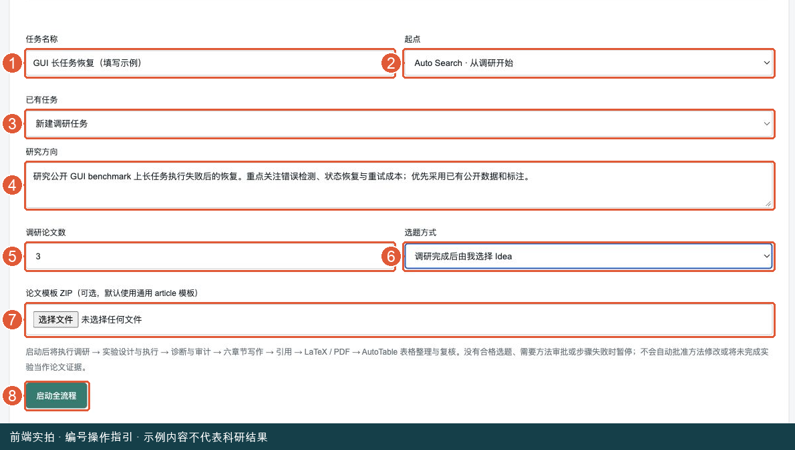

图中编号：1 任务名称；2 起点；3 已有任务；4 研究方向；5 论文数；6 手动或自动选题；7 可选模板；8 启动全流程。图中仅填写示例，未点击启动。


回到“工作台”，点击右上方“新建全流程”。按下面顺序填写。

| 字段 | 怎么填 | 示例或注意事项 |
| --- | --- | --- |
| 任务名称 | 可选，填便于辨认的研究名 | GUI 长任务恢复；留空默认使用方向，最多 120 字符 |
| 起点 | 第一次选“Auto Search · 从调研开始” | 已有实验或论文时可换成 Design 或 Writing |
| 已有任务 | 从头开始保留“新建调研任务” | 选择已有调研后，研究方向输入框会隐藏 |
| 研究方向 | 填具体问题和边界 | 最多 1000 字符，参考第 3 章 |
| 调研论文数 | 初次可保留 3 | 首页提供 2、3、4、5、6 |
| 选题方式 | 初次建议“调研完成后由我选择 Idea” | 自动模式按既有评审选择合格首选 |
| 论文模板 ZIP | 有正式模板时选择，否则留空 | 可选；默认通用 article；单模板最大 20 MB |

检查完点击“启动全流程”。按钮进入提交状态时等待响应，不要连续重复提交。创建成功后，左侧出现该流程，右侧显示当前阶段和消息。

### 4.2 一个从零开始的操作例子

本例只演示操作路径，不承诺生成特定科研结论。

1. 任务名称填“GUI 长任务恢复”。
2. 起点选 Search，已有任务保留“新建调研任务”。
3. 研究方向填第 3.1 节示例，论文数选 3。
4. 选题方式选手动，暂不上传模板。
5. 点击“启动全流程”，等状态从运行中进入等待选题，或显示需要处理。
6. 点击“调研与 Idea ↗”，按第 5 章看完证据、方法和风险。
7. 返回首页选中原流程，选择一个可交接的 Idea。
8. 后续进入实验阶段，检查资源、计划和可能出现的方法审批。
9. 只有实验完成和证据检查通过，才会交接写作；写作之后继续表格整理。
10. 流程完成时点击“最终表格、PDF 与下载 ↗”，查看最终 PDF 并下载完整产物。

### 4.3 怎样读流程详情

顶部四个阶段依次是“01 调研与选题”“02 实验与审计”“03 论文与 PDF”“04 表格与复核”。当前阶段会突出显示，但你还需要阅读其下的具体消息。

| 显示状态 | 意思 | 现在该做什么 |
| --- | --- | --- |
| 运行中 | 正在推进当前步骤 | 查看消息或模块日志，等待 |
| 等待选题 | 需要你指定候选 | 阅读 Idea 后点击采用 |
| 等待审批 | 方法修改需要决定 | 阅读完整提案再批准或拒绝 |
| 需要处理 | 某一步存在阻塞或错误 | 展开错误，修复后继续 |
| 已暂停 | 没有自动继续推进 | 确认原因后重试 / 继续 |
| 已完成 | 当前流程达到交付条件 | 进入最终模块下载并检查 |

“完整推进与交接记录”按时间显示流程发生过什么。想了解最初输入，可展开“完整研究方向”。页面刷新后再次选中原任务即可，不必重建。

### 4.4 手动选题怎么操作

在“等待选题”时，详情区显示候选标题、评审结论和风险。先通过“调研与 Idea ↗”看完整内容，再回来点“采用此 Idea 并继续”。

候选按钮显示“已放弃，不可交接”且变灰时，该项不满足交接条件，不要把它当作可执行选题。没有候选时，去 Search 看是否调研失败、方案被放弃或尚未完成。

自动模式当前只自动采用评审值为 `promising`、未被人工废弃的首选候选。Search 上显示的“强”与“潜力”是模型标签，不要自行推断任何分数都能触发自动交接；没有合格自动选题会停下来等待处理。

### 4.5 方法审批怎么操作

出现“方法修改提案 · 编号”后，先阅读完整提案，确认改动内容、原因及影响。

- “批准指定修改”：批准当前 Revision ID 对应的提案。
- “批准本次例外修改”：达到原修改限制时的例外批准，先理解例外内容。
- “拒绝并暂停”：不同意当前修改并停止自动推进。

批准后已有决定会保留。恢复说明框中的“同意”“继续试试”等自然语言不能代替专门审批按钮。不要因为想让进度继续而跳过提案阅读。

### 4.6 暂停、继续与看日志

运行中可点击“暂停流程”。不同阶段的停法不同，见第 9.1 节；它不是所有进程立刻消失。

失败或暂停后，在“恢复说明”填已查明的情况，例如“已修复数据路径，请核对原运行记录后继续”，再点“重试 / 继续当前步骤”。系统会读取说明和既有状态，通常复用未失效的已完成内容。

点击“查看错误与日志”查看当前阶段的错误或调用记录。真正的训练进程可能独立存在；遇到控制器卡住时，“停止卡住的控制器”只是停止当前控制器，恢复前还要核对实验是否在跑。

### 4.7 接续已有任务

点击“新建全流程”，将“起点”改为所需阶段，选择对应“已有任务”。已有调研也可在 Search 起点下拉框中选择。

已有实验尚未达到交接门槛时，流程会继续检查实验状态，不会直接把未完成结果拿去写论文。已有 Writing 任务可接着推进论文和表格。已有独立任务不会因为在列表里出现就被自动接续，仍需你选择并启动新流程。

### 4.8 中途更换论文模板

未完成的流程详情底部可展开“更换论文模板”，选择新 LaTeX ZIP，再点“保存模板”。如果已进入表格阶段，系统会按流程控制停止并回到写作处理新的排版交接，旧产物保留。

模板更换影响排版链路。改完之后应重新检查最终 PDF，不应继续用之前下载的 PDF 当成新模板版本。

## 5. Auto Search：一步一步找问题、读 Idea

### 5.1 创建一个独立调研

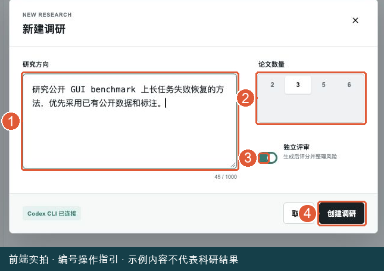

图中编号：1 填研究方向；2 选论文数量；3 保留独立评审；4 点击创建会立即启动调研。本截图停在提交前。


点击顶栏 Auto Search。左侧是“调研文件夹”，右侧是选中的 Idea。

1. 点击左侧“新建调研”。
2. 在“研究方向”中输入具体问题，至少 3 个字符，最多 1000 字符。
3. 在“论文数量”中选择 2、3、5 或 6，默认 3。这里与首页全流程选项略有不同。
4. 初次保留“独立评审”开启，它会在生成后评分并整理风险。
5. 查看弹窗底部是否报告服务或 Codex 配置异常。
6. 点击“创建调研”，系统会立即开始后台调研。

点击“取消”或右上角关闭是在提交前关闭表单；已经创建的任务需要使用停止按钮。

### 5.2 左侧文件夹怎么用

每个文件夹代表一次调研，不是一篇论文。任务运行中显示阶段、进度和转动图标；完成后显示 Idea 数量。

完成后点击文件夹旁边的小箭头展开，点击下面某个 Idea 标题在右侧阅读。多个文件夹和多个 Idea 可以来回切换。运行中的文件夹不可像完成文件夹那样展开阅读全部候选是正常行为，应先看进度或错误记录。

文件夹中候选右侧可能显示模型标签，也可能显示人工通过或废弃图标。这两种标记表达不同信息，不是同一套评分。

### 5.3 先读“概览”：判断问题是否成立

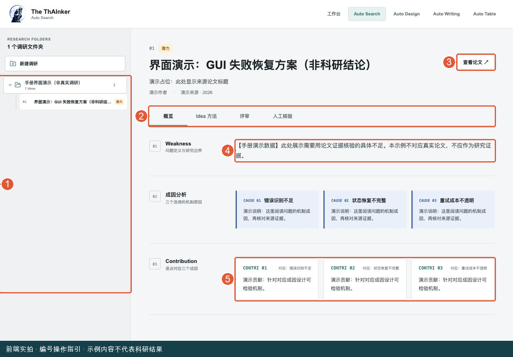

图中编号：1 在文件夹下选择 Idea；2 切换内容页签；3 正式任务中打开来源论文；4 先读 Weakness；5 再看贡献。本图为合成演示内容，不对应真实论文。


右侧顶部显示 Idea 标题、来源论文信息和“查看论文 ↗”。点击论文链接可在新页面核对原文。

“概览”按三个部分展示：

| 区块 | 该怎么看 | 建议问自己的问题 |
| --- | --- | --- |
| Weakness | 看问题定义与研究边界 | 原论文真的存在这个不足吗？ |
| 成因分析 | 看三个机制原因 | 原因是否清晰，还是换句话重复问题？ |
| Contribution | 看与成因逐点对应的贡献 | 每项贡献是否解决对应原因、能否实验验证？ |

推荐先把这一页读懂，再看复杂方法。若 Weakness 已经不成立，即使方法写得很长也不能说明方案值得实施。

### 5.4 再读“Idea 方法”：判断能否落地

点击“Idea 方法”。页面提供板块导航，点击条目跳到相应内容。按顺序阅读具体实现、数据集和 Benchmark、训练与评价流程等已有板块。

查看数据与 Benchmark 卡片时，核对名称、来源链接、下游任务、标注来源以及缺口与处理。不同候选的板块以实际生成结果为准。

你应至少弄清：输入是什么、处理步骤是什么、输出是什么、如何比较、需要哪些资源。只有想法，没有可获得的数据和明确评价方式，不适合直接进入正式实验。

### 5.5 看“评审”：分数不是最终决定

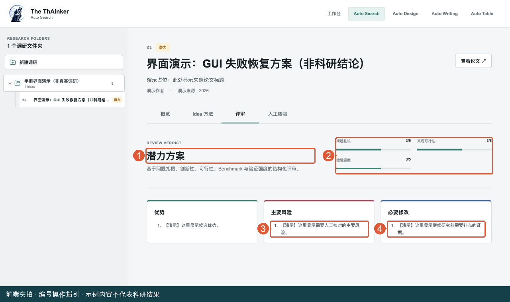

图中编号：1 先看评审结论；2 看各项评分；3 优先检查主要风险；4 阅读必要修改。分数是界面演示占位值，不是本次运行的模型评审。


点击“评审”，先看结论，再看优势、主要风险和必要修改。

| 页面标签 | 对应含义 | 推荐处理 |
| --- | --- | --- |
| 强 | `strong` | 继续核对证据和资源，不代表已验证 |
| 潜力 | `promising` | 值得进一步核验；自动全流程按当前规则筛选此值 |
| 待加强 | `weak` | 重点阅读风险和必要修改 |
| PASS | 放弃当前方案 | 不作为实验 Idea 交接 |
| 未评审 | 没有独立评审结论 | 不能当成已通过模型评审 |

评分包含问题扎根、成因质量、逐点对应、创新性、实现可行性、Benchmark、资源可行性、标注合规和验证强度等。先处理能否做和证据是否成立，再考虑分数排序。

### 5.6 做“人工核验”

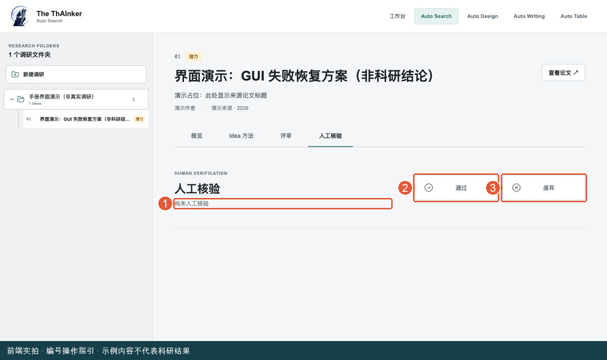

图中编号：1 核验状态；2 点击通过；3 点击废弃。再次点击当前已选项可以撤销；图中未保存任何核验决定。


点击“人工核验”。只有两个决定按钮：“通过”和“废弃”。

1. 读完论文、方法和评审后，点击与你判断相符的按钮。
2. 查看状态文案和左侧图标是否更新，确认保存成功。
3. 想撤销时，再点一次当前已选按钮，恢复为尚未核验。
4. 如出现“保存失败”，先处理提示，不要以按钮点击过就认为决定已保存。

“通过”只是你的候选核验记录，不表示实验成功；“废弃”也不会自动删除整个调研文件夹。要启动全流程，还需在首页接续并选题。

### 5.7 调研卡住、继续与删除

运行时文件夹行右侧有中止图标。点击后会弹出“停止调研并保留进度”，确认按钮是“停止并保留”。它保留论文、Idea 和评审产物，以后可以继续。

失败或停止后，文件夹旁出现“继续”。先展开“错误与恢复记录”查看问题，处理后点击继续，复用已有合法产物。

在文件夹行右键可打开菜单：“查看配置”显示方向、数量、是否评审、时间和文件夹；“删除调研”会弹出永久删除确认。删除会移除整次调研证据和方案，不能拿来代替停止。

### 5.8 Search 这一步完成的检查

你能指出候选对应哪篇论文，说明 Weakness、贡献、数据和验证方式，读懂主要风险，并完成必要人工核验。然后才考虑选题交接。

## 6. Auto Design：从 Idea 到真实实验

### 6.1 新建实验表单逐项填写

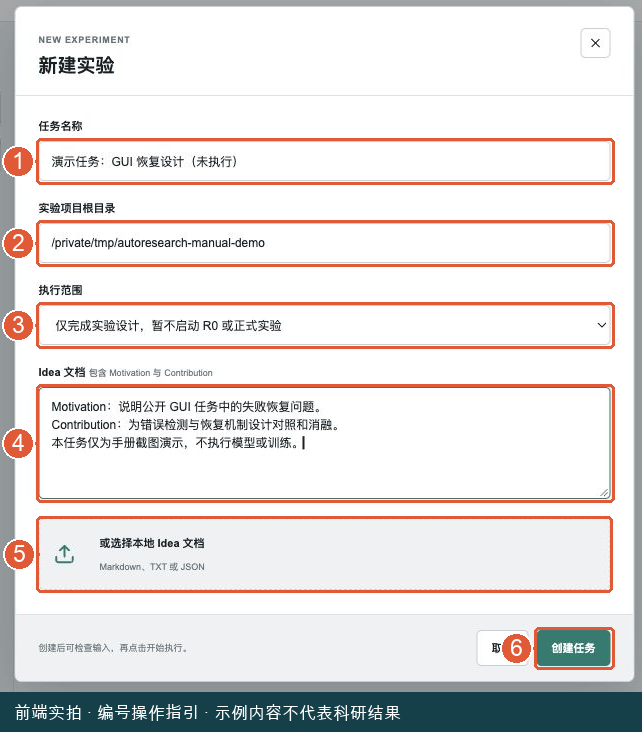

图中编号：1 名称；2 后台机器上的项目目录；3 仅设计或完整流程；4 Idea 内容；5 可选文件；6 创建任务。创建只保存输入，下一张图才是执行入口。


进入 Auto Design，点击左侧或中央“新建实验”。

| 字段 | 你应该填写什么 | 容易犯的错 |
| --- | --- | --- |
| 任务名称 | 简明研究名称，必填 | 多个不同实验都叫“测试”而难以辨认 |
| 实验项目根目录 | 运行服务的那台机器上的项目绝对路径 | 在服务器上填写自己电脑的下载目录 |
| 执行范围 | 初次可选仅设计，确认后再开实验 | 误以为完整流程只写文档 |
| Idea 文档 | 动机、贡献、已确定约束，必填 | 只有一句“帮我做实验” |
| 或选择本地 Idea 文档 | MD、TXT、JSON，选择后文本会填入 Idea 框 | 误上传 PDF 或忘记检查文件内容 |

“实验项目根目录”是服务器用来建立任务目录、查找机器上下文的项目位置；不是浏览器下载路径。页面通常会预填后台默认项目路径，不确定时先确认它是否正确。

选择文件后，内容会进入文本框。提交前仍可查看并修改。Search 的 PASS 放弃文档不能当作 Idea。

### 6.2 创建后，先看再运行

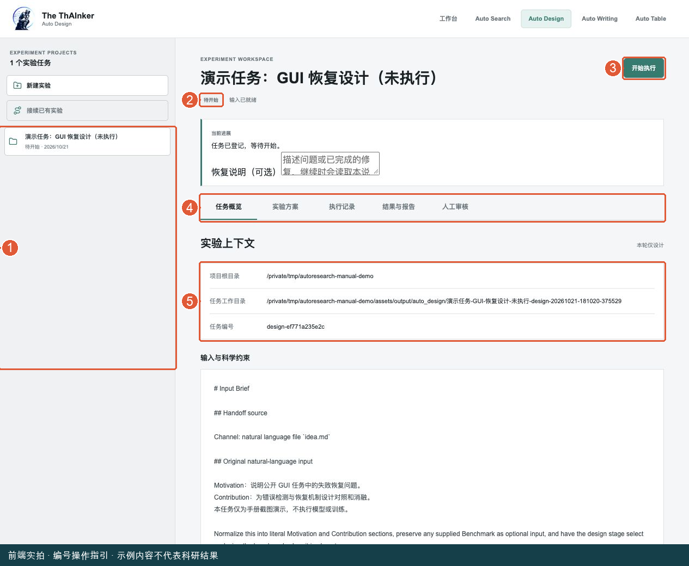

图中编号：1 左侧选任务；2 看状态；3 开始执行入口；4 五个内容页签；5 核对项目和任务路径。本图任务未执行，没有实验结果。


点击“创建任务”后，左侧出现任务，状态为“待开始”。此时不会立刻开始训练。

先在“任务概览”确认项目根目录、任务工作目录和输入与科学约束。发现输入不对时不要盲目执行。确认后点击右上角“开始执行”。

如果执行范围为“仅完成实验设计”，系统完成设计后显示“设计完成”，右上角变成“开始实验”。你可以先阅读方案，决定是否进入 R0 或正式实验。

### 6.3 五个页签分别看什么

| 页签 | 显示内容 | 建议何时打开 |
| --- | --- | --- |
| 任务概览 | 项目路径、输入、范围、状态推进记录 | 创建后和恢复前 |
| 实验方案 | 已保存的设计文档 | 开始正式实验前 |
| 执行记录 | 实验命令、退出状态、工作流调用日志 | 执行中、失败或怀疑卡住时 |
| 结果与报告 | 观测汇总、诊断、目标对比、审计、报告链接 | 有结果后 |
| 人工审核 | 当前方法修改提案、Revision ID 和决定按钮 | 待人工审核时 |

“尚未生成”或“尚无观测结果”通常意味着还没走到对应阶段。设计阶段没有结果并不是显示故障。

### 6.4 怎样判断实验推进到了哪

任务标题旁同时显示运行状态和科学阶段。运行状态回答“现在是否在工作”，科学阶段回答“研究推进到了哪里”。

| 科学阶段示例 | 新手理解 |
| --- | --- |
| 输入已就绪 | 输入已经保存 |
| 等待 R0 探测 | 先执行前置探测 |
| R0 返回设计 | 探测未满足要求，需回到设计 |
| 设计已接受 / 实现已就绪 | 方案或实现准备完成，尚不等于实验完成 |
| 实验执行中 / 实验执行完成 | 正在跑或已结束执行 |
| 结果诊断完成 | 已形成结果解释 |
| 等待方法修改批准 | 需要人工决定 |
| 审计通过 / 流程完成 | 已达到对应检查阶段 |

“排队中”表示等待当前实验服务调度，不一定是故障。服务一次推进一个实验任务；GPU 并行仍由实验计划和机器约束决定。

### 6.5 执行记录怎么读

打开“执行记录”，展开某条命令，可看见命令文本、工作目录、STDOUT 和 STDERR。标题中的 `exit 0` 通常表示该命令正常结束；非零值或未记录状态需要结合完整日志判断。

下方“工作流调用记录”按实验设计、实验执行、结果诊断、方法修改、独立审计列出调用。每项有“执行记录”“完整事件”“错误日志”链接。怀疑没有进展时先看最近一次调用，不要立即新建重复任务。

向维护者求助时提供任务名称、当前阶段、最近错误和相应日志，比只说“卡住了”更容易定位。

### 6.6 安全暂停与继续

运行或排队时可以点“安全暂停”。按钮可能变成“等待安全收尾”，此时系统正等待当前单元收尾，不应反复点击。

暂停或失败后出现“恢复说明（可选）”和“继续执行”。先确认原实验是否仍在运行，再写明已修复内容，点击继续。仅设计已完成的任务会显示“开始实验”，其作用是转入完整执行。

只有控制器确实卡住时，再用“停止卡住的控制器”。它会保留训练和产物；不能据此判断 GPU 训练已停止。

### 6.7 人工审核三个按钮的区别

出现“待人工审核”时，普通开始按钮会隐藏。打开“人工审核”，读完整提案和当前编号。

| 按钮 | 意思 | 后果理解 |
| --- | --- | --- |
| 批准指定修改 | 同意当前方法修改 | 后续可按已批准边界推进 |
| 批准一次例外修改 | 当前提案涉及例外授权 | 必须先理解为什么需要例外 |
| 暂不批准 | 拒绝当前修改决定 | 不是普通的运行暂停按钮 |
| 废弃当前 Idea | 放弃这个研究方案 | 不要当成“关闭弹窗”使用 |

没有待审批提案时，这些按钮不会显示。已完成或已废弃任务也不会像未完成任务那样继续执行。

### 6.8 结果表怎么读

“结果与报告”中显示实验/变体、任务/指标、均值、样本标准差、Seeds 数量和逐 Seed 值。

- 均值是已保存观测的汇总，不是预期目标。
- 单 seed 的标准差显示 N/A，不能推断实验稳定性。
- `INCOMPLETE` 表示证据尚不完整，页面数字只能用于诊断。
- “目标对比”是目标与观测比较，不代表目标已经实现。
- 展开“完整性审计”看具体结论；报告就绪后可点“打开报告 ↗”。

只有页面有数字还不够。全流程还要检查磁盘 COMPLETE、审计和原始证据，满足条件才进入 Writing。

### 6.9 接续旧实验

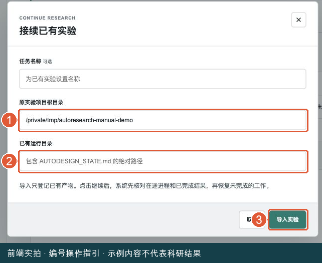

图中编号：1 填原项目根目录；2 填包含状态文件的已有运行目录；3 导入只登记，不自动执行。两个路径通常不同。


点击左侧“接续已有实验”，填写原实验项目根目录，以及包含 `AUTODESIGN_STATE.md` 的已有运行目录。任务名称可选。

两个目录不是同一个概念：根目录是原项目，运行目录是某一次任务实际保存状态和产物的位置。点击“导入实验”只登记，文件不搬家、不自动运行。检查导入的上下文后再继续。

## 7. Auto Writing：把实验材料写成论文

### 7.1 创建写作项目

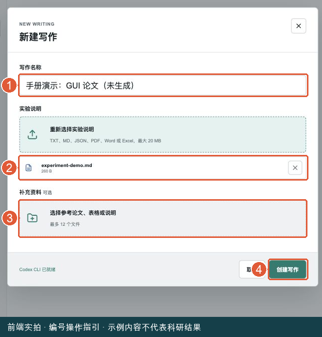

图中编号：1 写作名称；2 已选实验说明文件与移除入口；3 可选补充资料；4 创建写作。图中文件明确标注为手册演示材料。


进入 Auto Writing，点击“新建写作”。

| 字段 | 填写方式 | 限制 |
| --- | --- | --- |
| 写作名称 | 便于识别论文主题的标题 | 必填，最多 120 字符 |
| 实验说明 | 选择主要实验说明文件 | 必选，最大 20 MB |
| 补充资料 | 选择结果表、说明或参考论文 | 可选，最多 12 个 |

文件选择器接受 TXT、MD、JSON、JSONL、PDF、DOC、DOCX、CSV、TSV、XLS、XLSX。能选中某格式不等于里面的信息足够写论文；建议文字清晰、结果有来源、表格说明列名和单位。

文件选中后检查下方文件列表，选错可移除并重新选。点击“创建写作”后进入项目；还需要手动启动步骤，或点击自动完成。

### 7.2 用一个示例组织实验说明

建议自己创建 `experiment_description.md`，按下面标题填真实内容：

```text
论文主题：
研究问题与动机：
方法及各组件作用：
数据集、来源、划分和预处理：
实验环境、训练设置和随机种子：
主实验与消融的真实结果：
比较方法及其来源：
结论可以支持什么、不能支持什么：
局限与尚未完成工作：
原始记录和补充文件说明：
```

新手容易只上传一个没有列名和单位的表格。应在说明中告诉系统：每行代表什么、指标越大还是越小越好、数值是单次结果还是均值、标准差来自几次实验。

### 7.3 认识写作工作区

项目上方显示写作名称、实验说明文件、补充文件数量和完成进度。进度表示界面记录的内容完成情况，不能当成论文已可投稿的质量评分。

工作区页签为“写作流程”“参考文献”“路径约束”“排版发布”。在“写作流程”左边选择章节，右边阅读内容和执行当前步骤。

六章为 Introduction、Related Work、Method、Experiments、Conclusion、Abstract。Abstract 虽然通常出现在论文开头，但生成顺序在后，因为要总结已完成全文。

### 7.4 推荐新手先走一遍手动写作

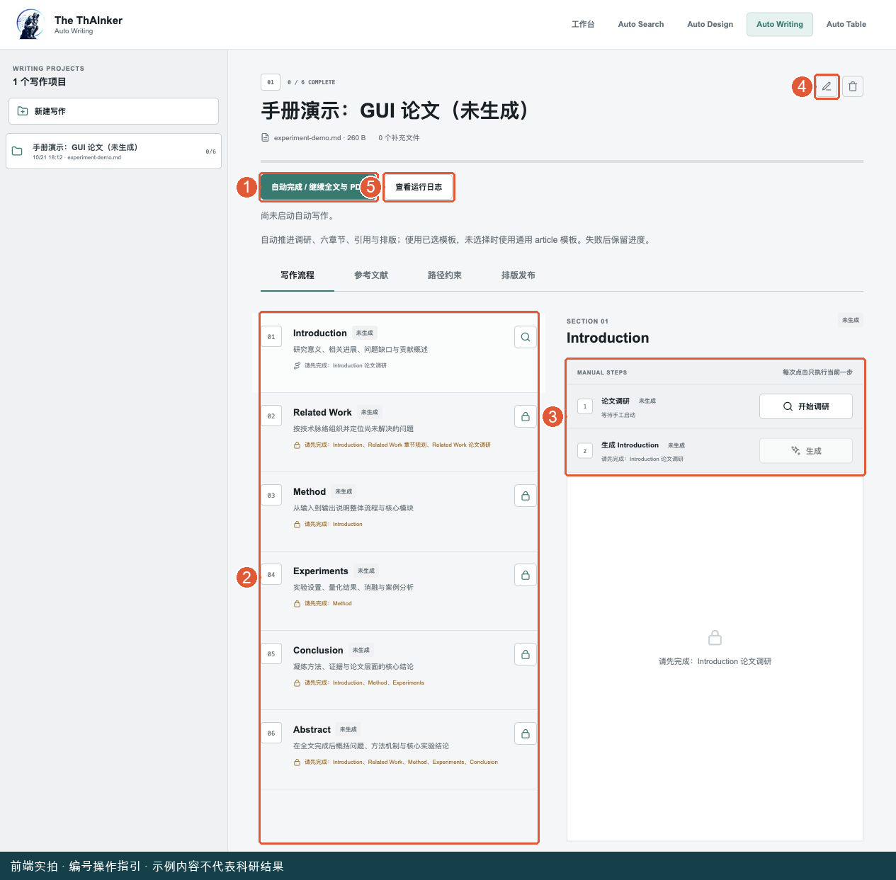

图中编号：1 自动完成入口；2 左侧选章节；3 右侧先调研、再生成；4 铅笔图标修改材料；5 查看日志。本图为未生成项目，灰色按钮展示前置条件限制。


| 顺序 | 在哪里点击 | 做什么 | 看到什么再往下走 |
| --- | --- | --- | --- |
| 1 | Introduction 的“开始调研” | 为引言找论文证据 | 调研已完成，有结果摘要 |
| 2 | 步骤右侧的“生成” | 生成 Introduction | 右侧出现正文，状态已完成 |
| 3 | Related Work 的“开始规划” | 规划三个 subsection | 规划已完成 |
| 4 | Related Work 的“开始调研” | 按规划寻找文献 | 调研已完成 |
| 5 | Related Work 的生成按钮 | 生成相关工作 | 状态已完成，能读正文 |
| 6 | Method | 生成方法 | 与实验材料中的方法一致 |
| 7 | Experiments | 生成实验章节 | 数据、设置和数字可核对 |
| 8 | Conclusion | 生成结论 | 不夸大实际证据 |
| 9 | Abstract | 总结全文 | 前面五部分有效且完成 |
| 10 | “参考文献”页签 | 调研并插入全文引用 | 文献任务已完成 |
| 11 | “排版发布”页签 | 选择模板并适配编译 | ZIP 和 PDF 可下载 |

每次手动点击只执行当前一步。Introduction 调研完成不等于 Introduction 正文已经生成；Related Work 规划完成也不等于调研和章节已经完成。

### 7.5 按钮变灰或显示锁怎么办

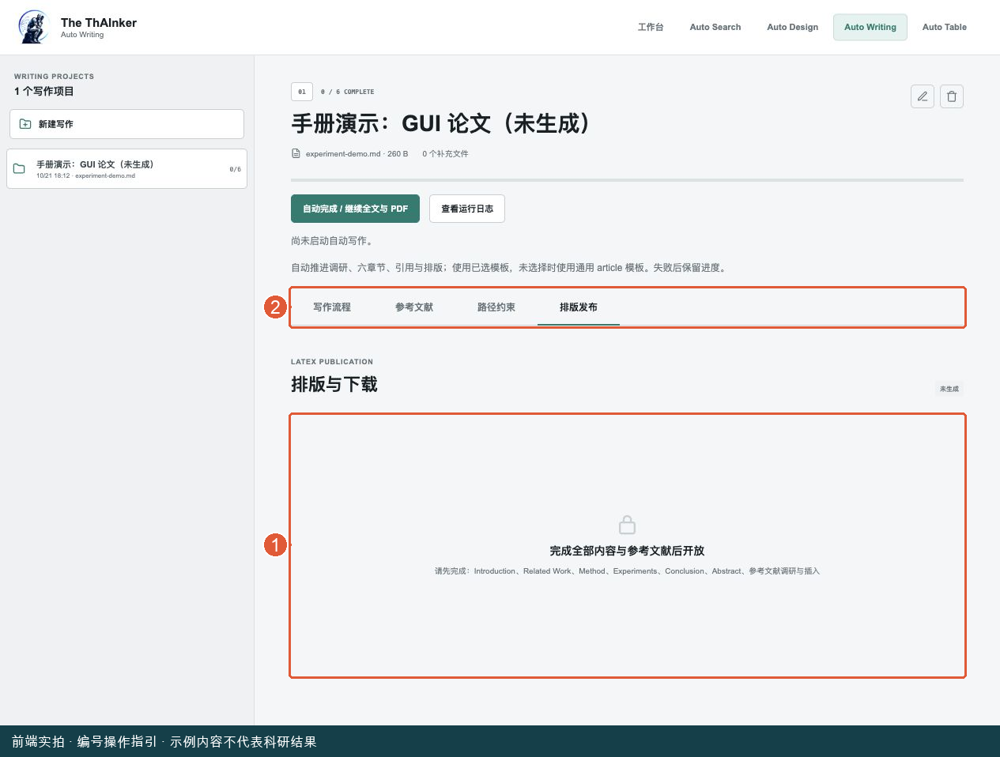

图中编号：1 这里列出未完成的章节与引用任务；2 返回写作流程或参考文献页处理。锁定提示是正常依赖检查，不是需要重复创建项目。


看按钮旁边的“缺少前置内容”提示，按提示去完成对应章节或调研。不要通过不停刷新来解锁。

同一项目已有任务进行中时，其他步骤可能暂时不可点击，这是防止相互覆盖。当前任务当前步骤按钮会变成“停止”，用于停止这一步。

步骤已完成后按钮可能变成“重新生成”“重新调研”或“重新规划”。这些会调用新的任务，不是打开已有内容的查看按钮。只想阅读时点击章节标题即可。

### 7.6 想省操作：自动完成 / 继续全文与 PDF

项目上方“自动完成 / 继续全文与 PDF”会按依赖推进文献调研、章节、引用和排版。已选择模板就使用该模板，否则自动流程可使用通用 article 模板。

运行时按钮变成“暂停自动推进”。暂停自动推进与立即停止当前调用不同：它让自动链路不再派发后续步骤，当前工作可能继续完成。想查看实际调用，点击旁边“查看运行日志”。

失败后保留进度。修复原因后再次点击自动完成 / 继续，会从首个未完成或需更新的步骤推进。若只坏在 PDF 编译，优先单独重编译，减少无必要的模型调用。

### 7.7 如何修改项目材料

点击项目标题区的铅笔图标（鼠标悬停提示“修改项目文件”），打开同名弹窗：

1. 可改写作名称。
2. “替换实验说明”不选新文件时，保留当前说明。
3. 现有补充资料可以删除，也可新增文件，保留与新增合计最多 12 个。
4. 检查列表后点“保存修改”。

替换、增删输入文件后，已有调研、章节和排版可能标记“需更新”。旧文字仍能看见，但不能据此认为它已经使用新材料。按依赖重新执行，再导出最终稿。

### 7.8 “参考文献”页签怎么操作

未完成前置内容时，该页显示锁定提示，列出缺少哪些章节。按提示返回完成后，再点击“调研并插入参考文献”。

页面显示 `数量 / 20-25`，是文献检查目标。覆盖卡片分别统计 Introduction P1、Introduction P2、Related Work、Datasets、Backbones、Baselines 等范围。数量够了也要检查每条是否真的支持正文。

文献列表展示标题、作者、年份、发表位置和引用键。点击来源图标打开原始来源。`\cite{...}` 是 LaTeX 正文中的引用标记，不是需要你在网页输入的密码或命令。

已有候选文献的“待补齐”不等于全文引用完成。执行完引用插入后，再核对状态是否为“已完成”。运行中按钮可变为“停止参考文献任务”；内容更新后可能需要“重新调研并插入”。

### 7.9 “路径约束”需不需要修改

该页是动态路径清单，列出实验说明、补充材料、章节、引用、模板、ZIP、PDF 和提示词所在路径。普通用户主要用于确认文件位置或向维护者提供线索，不需要在这里填写额外路径。

它不是文件上传入口，也不是论文正文编辑器。想换资料请点击铅笔图标“修改项目文件”，想换模板请去“排版发布”。

### 7.10 手动排版与下载

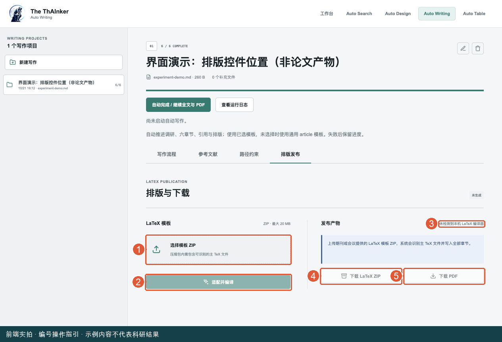

图中编号：1 选择模板 ZIP；2 适配并编译；3 查看编译器状态；4 下载源码；5 下载 PDF。本图用隔离的合成前置文件展示控件位置，没有生成论文或 PDF，因此下载与编译按钮尚不可用。


先完成全部章节和参考文献；未满足条件时页面会提示“完成全部内容与参考文献后开放”。

1. 打开“排版发布”。
2. 点击“选择模板 ZIP”，上传期刊或会议 LaTeX 工程，最大 20 MB。
3. 检查文件列表后点击“适配并编译”。
4. 等待状态和发布消息更新；成功后点击“下载 LaTeX ZIP”和“下载 PDF”。
5. 打开 PDF 检查标题、作者占位、摘要、公式、引用、图表和模板格式。

注意：手动“适配并编译”按钮在未选择模板时会变灰；自动完成可以走默认模板。这是前端两条操作路径的实际区别。

“部分完成”表示源码已经生成，但 PDF 编译没成功。此时通常可以保留或下载源码，查看下方编译日志，再点“只重试 PDF 编译”。没有 PDF URL 时，下载 PDF 链接不会可用。

### 7.11 删除项目会删什么

点击项目标题区的垃圾桶图标（提示“删除写作”）会出现确认框，说明项目目录、已生成内容和 resolved prompts 一并删除。先下载和备份需要保留的材料再决定。若只是想更换资料或重写一章，使用“修改项目文件”或重新生成，无需删除整个项目。

## 8. Auto Table：整理论文或用数据制表

### 8.1 先选对输入方式

进入 Auto Table，点击“新建表格项目”。先填项目名称，再从三种模式中选择。

| 你手上有什么 | 选哪个 | 不能混淆的地方 |
| --- | --- | --- |
| 可编辑 LaTeX 论文工程 | 论文 ZIP | 只有论文 PDF 不等于可替换的 LaTeX 工程 |
| 实验结果记录 | 实验数据 | 需要 CSV、TSV、JSON、JSONL，不能直接传 Excel 文件 |
| 已生成源码的 Writing 项目 | 接续 Auto Writing | 下拉框只列出已有 LaTeX ZIP 的可接续项目 |

每个文件最大 20 MB，总 HTTP 请求最大 32 MB。上传采用编码，请求还有额外开销，因此多个文件的原始大小相加接近 32 MB 时仍可能超限；尽量移除不需要的大文件。

### 8.2 路径一：整理已有论文表格

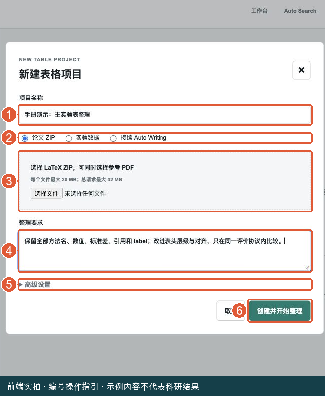

图中编号：1 项目名；2 选择论文 ZIP；3 上传 ZIP 与可选参考 PDF；4 写清整理要求；5 有需要才展开高级设置；6 创建后直接开始。截图尚未提交。


1. 名称填“主实验表格整理”等容易识别的标题。
2. 模式选“论文 ZIP”。
3. 上传包含主 TeX 和依赖文件的 ZIP，可同时选择一份参考 PDF。
4. 在“整理要求”说明目标和不能改的内容。
5. 多个主 TeX 文件时展开“高级设置”，填写 ZIP 内相对路径，例如 `paper/main.tex`。
6. 点击“创建并开始整理”，任务会立即开始。

整理要求示例：

```text
整理主实验表和消融表，保留全部方法名、数值、标准差、引用和 label。
让表头层级更清晰，数值按小数点或列方向对齐。
只在同一评价协议和可比较范围内突出最优结果。
不要用版式变化掩盖缺失值或不同实验设置。
```

主 TeX 是论文主入口，通常含文档声明和章节引用；不是任何一个表格 `.tex` 文件。没有多个主文件时，新手可先留空。动态宏拼出的路径可能无法直接识别，应提供能静态解析的工程。

### 8.3 路径二：实验数据制表

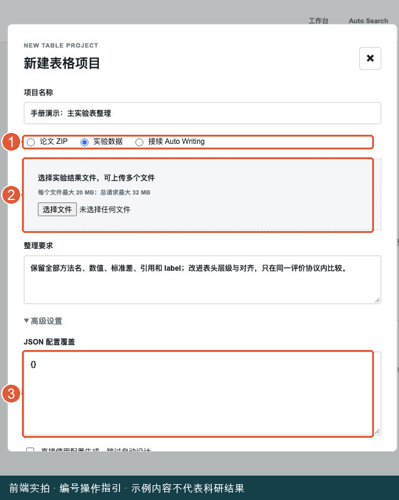

图中编号：1 切换实验数据；2 选择 CSV / TSV / JSON / JSONL；3 默认 JSON 保持 {}。展开高级设置后窗口变长，需向下滚动；下一张图展示下面的开关与提交按钮。


模式选“实验数据”，选择结果文件，填写整理要求。新手先保持高级 JSON 配置为 `{}`，不要随意勾选“直接使用配置生成，跳过自动设计”。

推荐长表格式，每行是一条观测，至少有 `method,dataset,metric,value`。有重复实验时附上 seed 等运行标识。

```text
method,dataset,metric,value,seed
Baseline,DemoSet,accuracy,0.81,1
Baseline,DemoSet,accuracy,0.82,2
Proposed,DemoSet,accuracy,0.84,1
Proposed,DemoSet,accuracy,0.85,2
```

上面是虚构练习数据，仅用于学习输入结构，不能作为科研证据。正式使用时替换为真实结果和准确方法名称。

整理要求可写：“accuracy 越大越好；按方法比较 DemoSet；重复 seed 汇总为均值和样本标准差；保留原始来源，不补造缺失值。”

| 列名 | 含义 | 填写提醒 |
| --- | --- | --- |
| method | 方法名称 | 使用正式名称，逐字保留 |
| dataset | 数据集或评价任务 | 不同任务不要混为一个 |
| metric | 指标名称 | 写清方向和单位 |
| value | 原始观测值 | 不要把百分数与 0-1 比例混用 |
| seed / run | 一次重复实验的标识 | 同一比较单元内不要重复编号 |

只拿到公开汇总值时可用 `method,dataset,metric,mean,sd,n`，如实标识汇总来源，不伪造逐 seed 数值。单次观测不会凭空生成标准差，缺失项保持缺失。

### 8.4 高级配置什么时候用

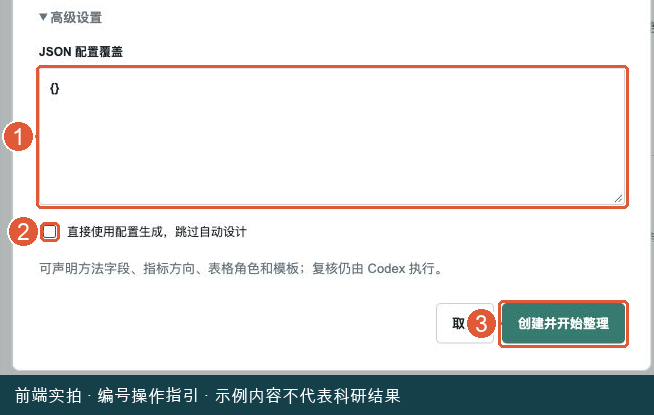

图中编号：1 JSON 配置覆盖；2 新手不要随意勾选跳过自动设计；3 创建并开始整理。此图刻意截取弹窗下半部分，与上一张合起来看。


只有你清楚字段、指标方向、表格角色和模板语义时，再覆盖 JSON。无效 JSON 会阻止提交。宽表里混有 epoch、参数量等数字字段时，应明确哪些是真正指标，避免将元数据当成结果。

“直接使用配置生成，跳过自动设计”只跳过自动设计，不会跳过后续独立复核。不确定时保留默认配置，并在整理要求里把数据含义讲清楚。

### 8.5 路径三：接续 Auto Writing

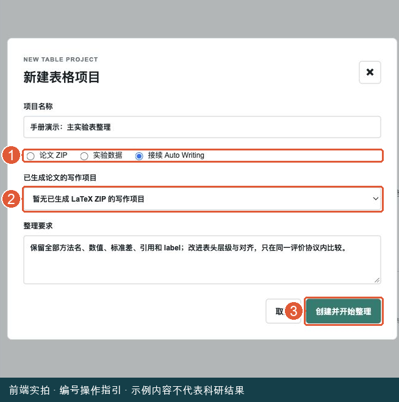

图中编号：1 选择接续 Auto Writing；2 在此选择已有 LaTeX ZIP 的项目；3 创建并开始整理。图中暂无可用项目，应先回 Writing 完成源码生成。


1. 模式选“接续 Auto Writing”。
2. 在“已生成论文的写作项目”中选择项目。
3. 填写本次整理要求。
4. 点击“创建并开始整理”。

如果列表显示“暂无已生成 LaTeX ZIP 的写作项目”，先回 Writing 完成排版源码生成。这个列表不是任意写作项目列表。接续会复制输入到新表格任务，原写作产物保留。

### 8.6 任务创建后看哪里

页头显示项目名称、当前状态、第几轮、输入文件数和创建时间。左侧是项目列表，右侧有“整理流程”“表格与 PDF”“输入与运行记录”。

“整理流程”的五步依次为：

| 步骤 | 在做什么 | 你重点看什么 |
| --- | --- | --- |
| 读取输入 | 识别源文件、表格与比较维度 | 找到的表数或数据条数是否合理 |
| 设计表格 | 确定角色、行列和层级 | 比较范围、指标方向是否正确 |
| 生成与替换 | 生成表格并替换论文对应内容 | 是否保留全部数值和来源 |
| 编译 PDF | 编译论文或独立表格 | 是否真正生成 PDF |
| 视觉与数据复核 | 逐页检查排版和证据 | 复核是否通过、检查了哪些页 |

右侧“设计与复核”显示规划理由、识别信息和复核意见。进度条主要按完成步骤计数，不是剩余时间估计。

### 8.7 看表格与 PDF，下载什么

切换“表格与 PDF”，每张输出卡片可能提供标题、caption、说明、LaTeX 源码、论文 ZIP 和“PDF 预览 / 下载”。有实际渲染页面时，可展开“查看实际 PDF 页面”，点击图片进一步查看。

检查方法名、数字、标准差、单位、脚注、缺失值和排序范围。论文模式还应核对替换了哪些表格，有无编译或替换警告。

页头出现“下载完整产物”后可下载本轮 `deliverables.zip`。即使文件已出现，也要结合任务状态和复核意见判断是否是最终可用版本。

### 8.8 失败、需要修改与重新设计

| 状态 | 怎么处理 | 会不会重新设计 |
| --- | --- | --- |
| 运行失败 | 看消息和日志，修复后“从当前步骤继续” | 一般复用已完成步骤 |
| 已暂停 | 核对后“从当前步骤继续” | 通常继续当前轮 |
| 需要修改 | 阅读负面复核，点“修改要求 / 重新设计” | 开启新一轮 |
| 已完成但还想改版式 | 点“修改要求 / 重新设计” | 开启新一轮 |

修改弹窗中可改“整理要求”，在“本轮修改说明”写明具体变化，例如“保留所有标准差，改为两层表头，禁止跨协议排名”，再点“开始新一轮”。旧输入和上一轮产物会保留。

运行中可以“停止当前任务”；修改要求按钮在运行中禁用。服务重启后任务显示暂停，不会自动重跑。

### 8.9 查看来源与完整记录

“输入与运行记录”分为运行记录、原始输入、产物与来源记录、提示词与执行日志。出现数值差异时，从这里追查原输入、配置和本轮文件。

任务“已完成”要求真实编译并通过独立复核。复核是 Agent 判断，你仍应亲自检查最终 PDF。不要把语义规格通过或某个文件成功生成，直接当成全部数据和排版都正确。

## 9. 暂停与故障：照这个顺序处理

### 9.1 四种“停”有什么区别

| 操作 | 适用场景 | 实际含义 |
| --- | --- | --- |
| 关闭或刷新网页 | 临时离开 | 通常继续后台运行 |
| 暂停流程 / 暂停自动推进 | 暂时不要做后续步骤 | 阶段不同，当前工作可能收尾后才停 |
| 安全暂停实验 | 实验需要暂时停调度 | 当前单元自然收尾，后续不再派发 |
| 停止卡住的控制器 | 当前模型控制器不响应 | 停止控制器，训练可能继续 |

Search 的“停止并保留”会停止当前调用；Writing 暂停自动推进允许当前步骤完成；Table 停止当前步骤并保留已有阶段。不要用删除任务来代替暂停。

### 9.2 任务看起来很久没有动

1. 确认自己选中的是正确任务，看最近更新时间、当前消息和阶段。
2. 打开对应模块日志：Search 的错误与恢复记录、Design 的执行记录、Writing 的运行日志、Table 的输入与运行记录。
3. 区分模型还在调用、真实命令仍在执行、任务正在排队、还是已经报错。
4. 有明确错误时先修复原因，再从当前步骤继续。
5. 控制器确实卡住时才中止它；实验恢复前先核对原训练和已完成命令。

没有统一的“多久就算卡死”。大实验和文献查询可能耗时不同，盲目重启会增加重复执行风险。

### 9.3 一个失败恢复示例

假设 Writing 的 Method 失败，其他已完成章节仍在：

1. 保持当前项目，不删除、不新建。
2. 点击“查看运行日志”，找到 Method 的错误。
3. 若是材料缺失，补充正确资料；若是环境故障，处理环境。
4. 注意资料变更会导致哪些上游或下游状态变为“需更新”。
5. 只重试需要的步骤，或点击“自动完成 / 继续全文与 PDF”。
6. 检查恢复后的章节和引用，再重新排版。

若问题仅在 PDF 编译，直接使用“只重试 PDF 编译”，不必先重新生成 Method。

### 9.4 首页服务恢复面板怎么用

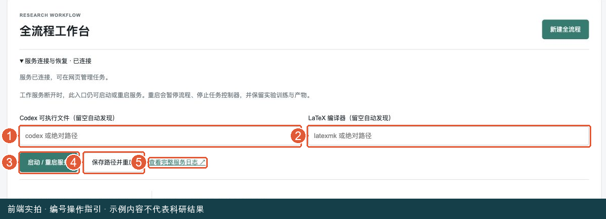

图中编号：1 Codex 路径；2 LaTeX 路径；3 启动 / 重启；4 保存路径并重启；5 完整服务日志。这里只定位控件，本次未改工具配置或执行重启。


展开“服务连接与恢复”。两个输入框分别是 Codex 可执行文件和 LaTeX 编译器，留空表示自动发现；它们是服务端工具路径，不是论文文件路径。

- 路径无需更改，只是工作服务断开：点击“启动 / 重启服务”。
- 明确需要新路径：填好后点击“保存路径并重启”。
- 需要排查启动错误：点击“查看完整服务日志 ↗”。

重启会暂停流程并停止受管理控制器，保留实验训练与产物。排空超时可能显示失败；不要据此强制结束训练。工作服务恢复后，回原流程点击继续。

如果连首页都打不开，说明可能是外层入口也没启动、端口或转发错误，此时网页无法自行修复，按附录启动或联系维护者。

### 9.5 求助时应该提供哪些信息

提供模块名称、任务标题和编号、当前阶段、错误原文、最近操作、已尝试修复以及日志位置。截图可附，但不应用截图替代完整错误。

不要把登录密码、API Key 或其他认证信息写进恢复说明、论文材料或公开日志。该提醒只用于整理故障信息，不是额外操作步骤。

## 10. 常见问题速查

### 为什么我找不到刚才创建的任务？

先确认是不是切到了另一个模块。Search 文件夹、Design 实验、Writing 项目和 Table 项目各有独立列表。全流程则回首页左侧列表找标题。还要确认当前服务使用的是原来的数据目录。

### 为什么按钮的文字和手册有时不一样？

按钮会随状态变化。例如 Design 是“开始执行 → 开始实验 / 继续执行”，Writing 可变成“重新调研 / 停止生成”，Table 失败后是“从当前步骤继续”。按当前状态和旁边说明判断。

### 为什么能看旧正文，却显示“需更新”？

系统保留旧内容方便查看，但输入或前置内容已变化，旧版本不再代表最新材料。重新执行相关步骤后，再生成引用和 PDF。

### Search 人工通过后为什么没有自动开始实验？

人工通过只是核验记录。独立 Search 不会因此自动创建实验；需要首页建立全流程并接续选题，或把完整 Idea 放入 Design 新任务。

### 我可以只做设计，不跑训练吗？

可以。在 Design 新建表单里选“仅完成实验设计，暂不启动 R0 或正式实验”。完成设计后先查看方案，只有另点“开始实验”才进入执行范围。

### 为什么选择了完整流程，却还在等我批准？

自动流程不自动批准方法变更。阅读当前提案并使用审批按钮决定，普通“继续”不能替代审批。

### 为什么参考文献 / 排版页被锁住？

缺少前置章节或引用任务。看锁定提示列出的缺项，返回写作流程补齐。不是所有锁都由服务异常造成。

### 为什么手动适配按钮不能点？

除前置任务外，还要在手动排版页选择模板 ZIP。自动完成路径可使用默认模板，手动路径当前需要选定模板。

### PDF 失败了，是否必须重写整篇论文？

通常不需要。源码已生成而编译失败时会显示“部分完成”，查看日志并只重试 PDF 编译。仍可保留可下载的 LaTeX ZIP。

### Table 可以只上传论文 PDF 吗？

论文整理路径需要可编辑 LaTeX ZIP，PDF 是可选参考。只有 PDF 无法按该路径替换原工程中的表格。

### Table 能直接上传 XLSX 吗？

当前实验数据入口接受 CSV、TSV、JSON、JSONL。先将工作表导出为这些格式，并保留字段、单位和来源；Writing 的资料入口支持 Excel，不代表 Table 的数据入口也支持。

### 我换了一台电脑，路径应该填哪台机器的？

Design 项目路径和服务工具路径属于后台所在机器；浏览器上传文件从你当前电脑选择。远端服务器不会自动拥有你电脑上的绝对路径。

### 什么才是最终完成？

独立模块看该模块的状态和产物。新建四阶段全流程则必须到 Table 编译与逐页复核通过，才是整条流程完成。Writing 的 PDF 是中间论文产物，最终流程下载通常位于 Table。

## 11. 交付前最后一次人工检查

### 11.1 调研和实验检查

能打开关键论文来源，Weakness 与证据一致；所用数据、标注、划分与评价协议明确；实验结果来自真实记录；seed 和标准差口径正确；方法修改已有明确决定；审计中的缺项没有被忽略。

### 11.2 论文检查

正文方法与实际实现相符；图表数字能回到原结果；结论不过度扩大；作者与单位占位已处理；引用真实存在且支持论述；模板满足你的目标要求。通用 article 不自动代表满足某个会议或期刊格式。

### 11.3 表格和下载检查

从最终任务下载 PDF 和完整工程包，打开所有页面检查。确认无溢出、缺字、乱码、空白表、截断表头；方法名、数值、误差、缺失值和排名范围与原始数据一致；保留复核报告和输入来源。

建议在个人归档中标明日期与任务标题，并同时保存源码包和实验记录。只保存最终 PDF 方便阅读，但不足以恢复或复现研究。

## 附录 A：启动和远程访问

本附录供需要自己启动服务的用户或维护人员使用。日常网页操作不需要反复安装依赖。

在项目根目录、Python 3.11+ 环境下首次安装：

```bash
python3 -m venv .venv
source .venv/bin/activate
python -m pip install -e .
python -m workbench --port 8760
```

打开 `http://127.0.0.1:8760/`。模型步骤需要已认证的 Codex CLI；编译 PDF 需要兼容 LaTeX 编译器。实验还需要相应数据和计算环境。

远端项目可在服务器运行：

```bash
cd /root/autodl-tmp/yzb/autoresearch
python3 -m workbench --host 127.0.0.1 --port 8760
```

自己电脑另开终端连接并转发：

```bash
ssh -p 45017 -L 8760:127.0.0.1:8760 root@connect.westd.seetacloud.com
```

保持连接，本机访问同一 HTTP 地址。密码通过终端交互输入。以上服务器路径和连接方式来自任务上下文，本次没有连接远端验证。

## 附录 B：文件存放与备份

统一工作台数据默认在 `assets/output/workbench/`，包括全流程关联、Search、Writing、Table 和 Design 索引。Design 实际任务目录在所选项目的 `assets/output/auto_design/`，可能位于工作台数据目录之外。

Table 输入和日志还分别在工作区 `assets/input/auto_table/` 与 `assets/logs/auto_table/`。以任务显示的实际路径和索引为准。备份前先安全暂停，确认写入收尾，同时保存运行数据、实验目录、原始输入和日志。

文件夹采用“标题-模块-北京时间戳”命名。网页中改标题不会移动旧文件夹。迁移机器之后要重新确认绝对路径和工具环境。

## 附录 C：本手册依据与验证范围

本版重点检查了首页、Search、Design、Writing、Table 的 HTML，以及 `workbench/web/pipelines.js` 和四模块 `web/app.js` 中的表单、点击处理、状态映射、禁用条件、下载和错误行为。数据输入规则额外参考 `auto_table/references/input-contract.md`。

截图已加编号框选，原图与标注图保存在 docs/manual-images/。候选阅读和解锁后的排版控件使用明确标记的合成演示数据，不对应真实论文、模型评审或科研产物。

本文按实际前端行为编写，未为不存在的功能编造按钮；本次已在隔离演示工作台打开真实前端、填写表单、创建未执行的演示任务并截取页面；未做模型与实验全链路验收，也未将假数据作为真实科研结果。示例仅供理解输入方式。

此前本地轻量探针在隔离临时数据目录中验证：首页和四模块页面、四模块健康接口及流程列表共 10 个只读请求均返回 HTTP 200；启动帮助正常；表格引擎能列出 7 种模板。详细结果位于 `docs/manual_probe_results.json`。

这些验证说明本地入口和基础接口可用，不证明模型认证、文献检索质量、GPU 训练、完整科学审计或论文 LaTeX 编译已通过。软件行为依据本地快照，远端若为不同版本，按钮和状态应以对应版本页面为准。
