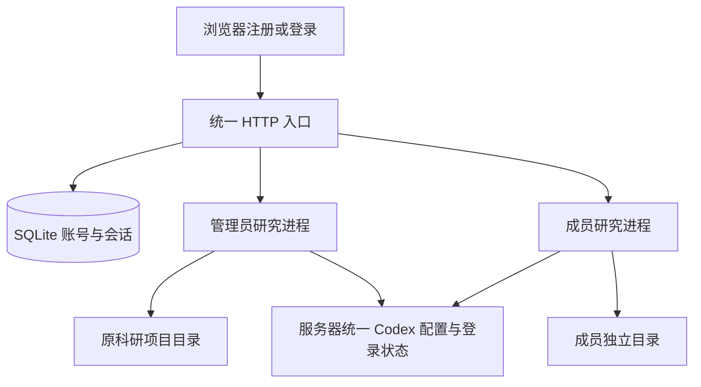

# AutoResearch 账号管理

## 0️⃣ 目标与方案

账号系统面向熟悉的团队成员，采用用户名和密码开放注册。首个管理员接管当前 `data-dir` 的科研项目，后续账号获得空的独立工作空间。所有账号复用服务器上的 Codex 登录状态、模型配置与计算资源。

| 需求 | 实现 |
| --- | --- |
| 注册与登录 | 沿用平台灰白、青绿色、Inter 字体与 The ThAInker 标识 |
| 账号存储 | Python 标准库 SQLite，数据库 schema version 为 1 |
| 项目归属 | 首个管理员绑定原数据目录，新账号按不可变 user ID 创建目录 |
| 运行状态 | 每个账号独立启动原五模块研究进程 |
| 统一 Codex | 使用服务器现有 CLI、登录状态和环境配置 |
| 管理员功能 | 查看账号、停用或启用、角色调整、密码重置、注册开关 |
| 个人账号功能 | 修改密码、退出登录 |

## 1️⃣ 按账号隔离研究进程

Search 的 `RUNS_ROOT`、`JOB_MANAGER` 和 Writing 的 `WRITING_RUNS_ROOT`、`GENERATION_MANAGER` 使用进程级状态。在请求间切换这些全局变量，会导致并发访问串到其他账号的数据目录。

统一 HTTP 入口先核验会话，再选择该账号的研究进程。原五模块内部的索引、后台线程与文件路径保留在所属进程中，科研流程、审批和暂停恢复沿用现有实现。



研究进程在账号首次访问研究接口时启动。退出登录后，已启动的科研任务继续运行。停用账号会撤销其会话，并关闭该账号的任务控制器。重新启用后可继续读取原有项目。

隔离检查覆盖网页、任务 API、下载、流程关联、服务日志和实验目录导入。新账号的 Auto Design 工作目录与导入目录必须位于自己的 workspace。生成的 HTML 报告带 sandbox 响应头，报告脚本使用独立浏览器源。

本轮采用同一宿主机上的进程与文件目录隔离。科研执行器继续拥有当前操作系统用户的权限，因此部署对象按熟悉的团队成员设定。通过科研代码主动访问宿主机其他文件的行为，仍受共享操作系统权限影响。

## 2️⃣ 数据目录与历史项目

```text
<data-dir>/
  accounts.sqlite3
  .account-setup-token
  service_settings.json
  auto_search/
  auto_design/tasks.json
  auto_writing/
  auto_table/
  auto_figure/
  pipelines/
  users/<user-id>/workspace/
    AGENTS.md
    assets/output/workbench/
      auto_search/
      auto_design/tasks.json
      auto_writing/
      auto_table/
      auto_figure/
      pipelines/
    assets/output/auto_design/<task-id>/
    assets/logs/workbench/service.log
```

首个管理员的 `legacy_owner` 标记绑定原 `workspace` 和 `data-dir`。Auto Design 索引登记的 `run_dir` 继续使用原路径，包含历史导入目录。其他管理员保留自己的科研工作空间，账号管理权限由 `role` 控制。历史项目归属账号需要保留管理员角色。

| 数据表 | 内容 |
| --- | --- |
| `users` | user ID、用户名唯一键、显示名、密码散列、角色、状态、历史项目归属、创建与登录时间 |
| `sessions` | 会话令牌 SHA-256、user ID、CSRF 令牌、过期时间 |
| `settings` | 注册入口开关 |
| `login_attempts` | 来源与用户名组合的失败计数、时间窗口 |

密码使用独立随机盐和 scrypt，参数为 `N=32768, r=8, p=3`。Cookie 使用 `HttpOnly`、`SameSite=Lax`，会话有效期为 7 天。修改或重置密码、停用账号会撤销对应会话。连续 10 次错误登录触发该来源与用户名组合的 15 分钟限制。参数参考 OWASP 的密码存储与会话建议。[密码存储](https://cheatsheetseries.owasp.org/cheatsheets/Password_Storage_Cheat_Sheet.html) · [会话管理](https://cheatsheetseries.owasp.org/cheatsheets/Session_Management_Cheat_Sheet.html)

## 3️⃣ 启动与管理员初始化

在已有 Python 3.11 及以上的项目环境运行。

```bash
.venv/bin/python3 -m workbench --host 127.0.0.1 --port 8760
```

1. 打开工作台，首次进入管理员初始化页，用户名预填为 `admin`。
2. 将启动终端打印的一次性初始化口令填入页面，设置管理员密码。
3. 初始化成功后进入工作台，历史项目按原 `data-dir` 归入该账号。
4. 团队成员在登录页选择“注册账号”创建自己的账号。
5. 管理员从右上角账号菜单进入“账号管理”。

初始化口令保存在 `<data-dir>/.account-setup-token`，文件权限为 `0600`，管理员创建成功后删除。账号数据库权限为 `0600`。密码要求 6 到 128 个字符，用户名支持 3 到 32 位字母、数字、下划线、点与连字符。

通过 HTTPS 反向代理部署时，启动入口加上 `--secure-cookies`，或设置 `AUTORESEARCH_SECURE_COOKIES=1`。沿用实际 `--workspace` 与 `--data-dir`，以便关联服务器原有项目。

Codex CLI 与编译器路径由管理员维护，统一保存在 `<data-dir>/service_settings.json`。配置在相应研究进程重启时加载，成员可重启自己的研究进程。

忘记管理员密码时，在服务器本机执行密码恢复，交互输入新密码。自定义数据目录时补充 `--data-dir <实际数据目录>`。

```bash
.venv/bin/python3 -m workbench.accounts --username admin
```

### 数据库备份

使用 SQLite backup API 生成一致的账号库快照，并与科研目录一并保存。

```bash
.venv/bin/python3 - <<'PY'
from pathlib import Path
import sqlite3

source = Path('assets/output/workbench/accounts.sqlite3')
target = Path('assets/output/backups/accounts.sqlite3')
target.parent.mkdir(parents=True, exist_ok=True)
with sqlite3.connect(source) as current, sqlite3.connect(target) as backup:
    current.backup(backup)
target.chmod(0o600)
PY
```

## 4️⃣ 接口与代码位置

| 接口 | 使用范围 |
| --- | --- |
| `GET /api/auth/session` | 查询登录状态与 CSRF 令牌 |
| `POST /api/auth/setup` | 使用一次性口令创建首个管理员 |
| `POST /api/auth/register` | 注册成员 |
| `POST /api/auth/login` | 登录并设置 Cookie |
| `POST /api/auth/logout` | 撤销当前会话 |
| `POST /api/auth/password` | 验证当前密码后修改密码 |
| `GET /api/admin/users` | 管理员读取账号列表 |
| `POST /api/admin/users/<user-id>` | 管理员更新角色、状态或密码 |
| `POST /api/admin/settings` | 管理员切换注册入口 |

浏览器 `account.js` 给同源 API 写请求附加 `X-CSRF-Token`，并发送预期账号 ID。账号切换后，旧页面需要重新登录。入口对匿名 API 返回 `401`，对匿名页面跳转到登录页。研究进程还验证入口生成的内部访问令牌。

| 文件 | 职责 |
| --- | --- |
| `workbench/accounts.py` | SQLite、密码散列、会话、账号状态、密码恢复 CLI |
| `workbench/supervisor.py` | 登录路由、CSRF、权限、账号进程与原服务恢复 |
| `workbench/server.py` | 内部进程访问令牌与账号目录约束接入 |
| `auto_design/orchestration.py` | 检查新建和导入目录的账号边界 |
| `workbench/web/login.html`、`login.js` | 初始化、注册、登录 |
| `workbench/web/account.js` | 账号菜单、修改密码、退出与会话请求 |
| `workbench/web/accounts.html`、`accounts.js`、`accounts.css` | 管理页与账号样式 |
| `workbench/tests/test_accounts.py` | 账号和双账号真实进程验收 |

## 5️⃣ 验收记录

2026-11-12 已完成真实 Chrome 浏览器的 7 组验收，记录位于 `assets/logs/accounts/browser-results.json`。覆盖管理员初始化、桌面和 390px 登录、注册、账号管理、注册开关、五模块账号菜单、成员项目隔离与密码重置对话框，页面脚本异常为 0。手机模块导航采用横向滚动，账号菜单保留在顶栏。

最终 Python 回归为 **171 passed、4 deselected**，JUnit 文件位于 `assets/logs/accounts/pytest-results.xml`。最终账号与原服务恢复专项为 **20 passed**，覆盖带 Origin 与 CSRF 的真实删除入口、报告 sandbox、历史目录归属、双账号进程与下载隔离、停用后进程关闭、重新启用恢复原项目，记录位于 `assets/logs/accounts/targeted-results.xml`。Ruff、JavaScript 语法检查和 `git diff --check` 通过。

沿用本轮开始前记录的 4 项基线失败，并在回归命令中明确排除。两项 Figure 流程用例依赖本机缺少的 `.venv-figurecrafter/bin/python`，另两项旧删除测试的请求缺少当前接口要求的 `DEL` 确认信息。

正常本地入口已在 `http://127.0.0.1:8760/` 启动，等待维护者在首次页面设置管理员密码。浏览器工程账号位于 `assets/logs/accounts/ui-workspace/` 与 `assets/logs/accounts/bootstrap-workspace/`。本机默认工作台索引在开发前为空，历史数据归属另由构造原目录的真实进程测试验证。部署到研究服务器时，继续传入服务器实际的 `workspace` 与 `data-dir`。

## 💡 当前运行边界

数据库保存账号、会话与注册配置，科研内容继续使用原有文件合同。每个活跃账号常驻一个研究进程，包含五个模块服务，内存消耗随活跃账号数增长。Codex 调用配额和 GPU 仍是共享资源，实验执行继续遵守项目机器指令与任务合同。

## 6️⃣ 服务器部署适配

2026-11-12 已将账号版增量部署到 `/root/autodl-tmp/yzb/autoresearch`，使用服务器项目的 Python 3.12 环境。SSH 端口更新为 `54025`。守护程序通过 `/api/auth/session` 验证入口就绪，支持管理员初始化之前的健康检查。

服务器原有 13 个 Auto Design 任务，以及 Search、Writing、Table、Figure 和 Pipeline 目录继续由首个管理员接管。部署核验的 25 个额外修改源码文件内容一致。覆盖前源码保存在服务器 `assets/output/account-deployment/backup/`。

服务器专项为 **26 passed**，包括新登录入口、双账号隔离、账号停用后进程关闭与重新启用、原服务恢复和守护逻辑。记录位于服务器 `assets/logs/account-deployment/tests.xml`。

服务器已创建 `admin` 管理员并绑定历史科研目录，团队成员继续通过开放注册获得空项目空间。服务器版通过 SSH 转发的 `http://127.0.0.1:18760/` 访问，手机公网入口需要接入云平台网页访问服务。具体启动方式见 [服务器部署说明](../deployment/README.md)。

## 7️⃣ 统一后端与绘图恢复

2026-11-12 已将截图中的 Codex 0.167.2 和现有 ChatGPT 登录复制到本项目私有运行目录。统一入口为 `.tools/codex/bin/codex`，登录凭据为 `.cache/codex/auth.json`。原 `.venv-figurecrafter` 已在原路径重建为 Python 3.12.14，原环境保存在 `assets/output/backend-restoration/python-env-backup/`。绘图依赖、CairoSVG 和项目内 LibreOffice 已安装。

绘图、写入边界和流程衔接共 **37 项测试通过**。可编辑 PPTX 已实际转成 PDF、PNG，绘图子进程在写入边界内通过真实 Codex 图片调用识别了两个框中的文字。当前在线研究进程的 Figure 健康接口显示 Python、Codex、LibreOffice 和默认参考图均可发现。25 个受保护的服务器科学源码文件内容核验一致。

服务器直连 ChatGPT 超时，现有配置中的 `7890` 端口未监听，当前也没有 Clash/Mihomo 进程。真实文本和图片调用通过当前电脑代理的临时 SSH 反向转发验收。后续采用下述按 SSH 连接分配代理的方案。早期原生命令验证超时记录已保留，显式 SSE 配置后的命令工具与模型调用验收已通过。清单与产物位于 `assets/output/backend-restoration/`，日志位于 `assets/logs/backend-restoration/`。

## 8️⃣ 每位访问者使用本机代理

访问方式继续采用“一条 SSH 命令 → 打开网页”。命令见部署说明，新增 `-R 127.0.0.1:0:127.0.0.1:7890`，服务器端口自动分配，客户端 `7890` 按本人代理端口填写。连接绑定由登录入口根据 SSH 进程自动识别。

同一账号通过两个 SSH 连接访问时，任务分别使用各自连接。HTTP 请求上下文通过后台线程传给 Search、Design、Writing、Table 与 Figure 的模型子进程，全流程自动交接保存连接归属，重新连接并继续任务后使用新的连接。平台的连接代理模式会清除科研进程继承的公共代理配置，模型调用使用当前任务的代理。

账号菜单新增“本机代理连接”，可查看 SSH 隧道状态并运行真实 Codex 命令读取校验。CLI 使用显式 ChatGPT SSE provider，服务器继续统一维护 Codex 登录身份。连接异常和代理拒绝请求会保留失败记录与任务产物，供重新连接后恢复。

服务器共有 184 项账号、连接上下文、双连接中继、后台线程、流程交接及绘图回归测试通过，新增检查的最终记录位于 `assets/logs/connection-proxy/server-tests.xml`。真实 CLI 已执行 `cat proof.txt` 并返回随机文件内容，AutoTable 原有模型适配器也通过了真实调用。双连接测试采用同一台电脑上的两个 SSH 客户端，其中一条连接使用返回 HTTP 407 的测试代理。代理归属记录在连接上下文和流程记录中，账号数据库结构沿用原 schema version 1。正式入口已完成连接识别与真实命令校验。图片适配器的连接复验遇到模型容量限制，失败日志已保留。
